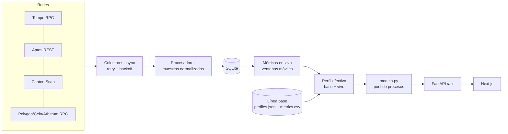
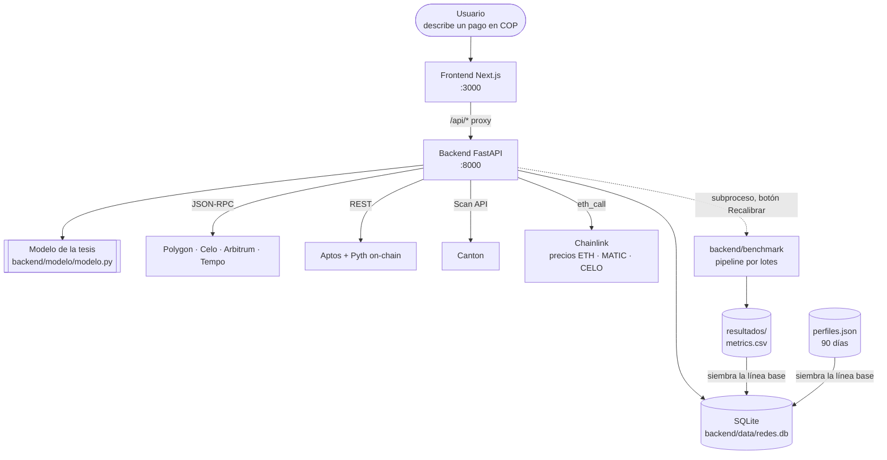

# Monitor de redes y recomendación de liquidación

Benchmark de tesis que compara **Polygon, Celo, Arbitrum, Tempo, Aptos y Canton** como destino de liquidación de pagos en Colombia (remesas, comercio y alto valor). Incluye una aplicación web que monitorea las seis redes casi en tiempo real y **recomienda** en cuál liquidar un pago en pesos colombianos con el modelo de la tesis. **Solo recomienda: no ejecuta transferencias.**

- **Resultados**: [resultados/benchmark.md](resultados/benchmark.md) (benchmark de las seis redes), [resultados/pruebas.md](resultados/pruebas.md) (banco de usuarios simulados) y [resultados/limitaciones.md](resultados/limitaciones.md). Cada uno tiene su versión `.html`.
- **Documentación**: [docs/ARCHITECTURE.md](docs/ARCHITECTURE.md), [docs/DATA_PIPELINE.md](docs/DATA_PIPELINE.md) y [docs/MODELO.md](docs/MODELO.md).

## Regla de oro

Ninguna métrica se puntúa si su valor no puede derivarse de una consulta reproducible al registro público de la red. Nunca se completa un valor con documentación, blogs o declaraciones de equipos. Un `no_computable` con su razón exacta es un resultado válido: un número mal calculado es peor que no computarlo. En la aplicación no hay datos simulados; lo que falta se muestra como falta.

## Ejecutar en local con Docker

Requisitos: Docker con Compose. No se necesitan claves de API.

```bash
git clone <url-del-repositorio>
cd Benchmark_Redes_Tesis_2026
docker compose up --build
```

| Servicio | URL |
|---|---|
| Frontend | http://localhost:3000 |
| Backend (API y `/docs`) | http://localhost:8000 |

El backend crea su base SQLite en el volumen `datos`, siembra la línea base y empieza a sondear las seis redes; tras un minuto ya hay métricas en vivo. Recorrido sugerido: `http://localhost:3000/es/start` (crea un usuario) → `/es/monitor` (estado de cada colector y de cada métrica) → `/es/transaction/new` (describe un pago y mira la recomendación) → `/es/simulation` (resultados del banco de simulación).

```bash
docker compose up -d --build     # en segundo plano
docker compose logs -f backend   # ver el sondeo
docker compose down              # detener (conserva los datos)
docker compose down -v           # detener y borrar la base de datos
```

Si el puerto 3000 u 8000 está ocupado: `FRONTEND_PORT=3100 BACKEND_PORT=8001 docker compose up --build` (en PowerShell: `$env:FRONTEND_PORT="3100"; docker compose up --build`).

### Solución de problemas

- **Windows con el repo dentro de OneDrive** (`invalid file request Dockerfile`): BuildKit no lee los archivos «solo en la nube». Lo más estable es clonar fuera de OneDrive (por ejemplo `C:\dev`). Alternativa: `powershell -ExecutionPolicy Bypass -File scripts\docker-up.ps1` (construye desde una copia en `%LOCALAPPDATA%`; `-Down` detiene).
- **`CERTIFICATE_VERIFY_FAILED`** (las seis redes aparecen caídas): un antivirus o proxy que intercepta HTTPS firma con su propia CA. Desactiva el análisis HTTPS o copia su certificado raíz (PEM, extensión `.crt`) en [certs/](certs/) y reconstruye con `docker compose build --no-cache`. En Windows, `scripts\docker-up.ps1 -ConfiarEnInterceptor` lo exporta. No se desactiva la verificación TLS en ningún punto.
- **RPC públicos limitados**: algunos proveedores gratuitos limitan o cambian (Polygon ya cambió de proveedor). Define otro con `RPC_POLYGON`, `RPC_CELO`, etc. (ver variables abajo).

## Ejecutar sin Docker

Requisitos: Python 3.11+, Node.js 22+ y pnpm (`npm install -g pnpm`).

```bash
pip install -r backend/requirements.txt      # idealmente en un entorno virtual
cd frontend && pnpm install && cd ..

cd backend && python -m uvicorn app.main:app --port 8000   # terminal 1: API y colectores (crea backend/data/redes.db)
cd frontend && pnpm dev                                    # terminal 2: UI en http://localhost:3000
```

`/api/*` del frontend se reenvía a `BACKEND_URL` (por defecto `http://127.0.0.1:8000`; se lee al arrancar). Con `COLECTORES_ACTIVOS=false` el backend usa solo la línea base. Para empezar con una base nueva, borra `backend/data/redes.db*`.

## Variables de entorno

Todas son opcionales; los valores por defecto funcionan sin claves (ver [.env.example](.env.example)).

| Variable | Para qué |
|---|---|
| `DB_PATH`, `CORS_ORIGINS`, `COLECTORES_ACTIVOS`, `REDES_ACTIVAS` | Base SQLite, orígenes permitidos, activar los colectores y qué redes sondear |
| `RPC_POLYGON`, `RPC_CELO`, `RPC_ARBITRUM`, `RPC_TEMPO`, `REST_APTOS`, `SCAN_CANTON`, `HERMES_PYTH` | Endpoints de datos; cámbialos si el público limita o cae |
| `RPC_ETHEREUM`, `RPC_ETHEREUM_RESPALDO`, `VENTANA_ANCLAJE_S` | Ethereum para el anclaje de Polygon, Celo y Arbitrum. Los nodos públicos solo guardan ~10 000 bloques, por eso la ventana es de 24 h |
| `APTOS_API_KEY` | Clave gratuita de Aptos Build/Geomi: sube el límite anónimo de 40 000 unidades cada 300 s por IP |
| `INTERVALO_*`, `VENTANA_*`, `OBSOLESCENCIA_S`, `REPLICAS_MONTE_CARLO` | Intervalos de sondeo (s), ventanas móviles, frescura (15 min) y réplicas del modelo (10 000) |
| `SIMULACION_TOKEN`, `SIM_PROCESOS`, `SIM_DIR`, `SIM_INTERVALO_S`, `SIM_SEMILLA` | Banco de simulación. Sin `SIMULACION_TOKEN`, los `POST`/`DELETE` de `/api/simulacion/*` quedan abiertos (solo local) |
| `BACKEND_URL` | Frontend: a dónde reenvía `/api/*` |
| `FRONTEND_PORT`, `BACKEND_PORT` | Puertos publicados por Docker Compose |

## Reproducir los resultados

Todos los comandos desde la raíz del repositorio.

### Benchmark de las seis redes

```bash
python backend/benchmark/main.py            # recalcula desde resultados/raw/ (sin tocar la red)
python backend/benchmark/main.py --collect  # vuelve a consultar Tempo, Aptos y Canton antes de calcular (lento)
```

Corre `compute_*` → `build_deliverables` → `score_engine`, imprime un reporte por red y bloque, y escribe `resultados/metrics.csv`, `gates.csv`, `scores.csv`, `sensitivity.csv`, `discrimination.csv`, `benchmark_final.csv`, `run_manifest.json` y, con el modelo de la tesis sobre las seis redes, `benchmark.md`, `benchmark.html` y `limitaciones.md`. La recolección usa `N_BLOCKS_TEMPO`, `N_BLOCKS_APTOS`, `MAX_PAGES`, `CANTON_START_AFTER` y `CANTON_MIGRATION_ID`; no ejecutes dos recolecciones de Aptos a la vez desde la misma IP.

La línea base de Polygon, Celo y Arbitrum es la medición de 90 días de la tesis (`backend/modelo/perfiles.json`); la de Tempo, Aptos y Canton sale de `resultados/metrics.csv`.

### Banco de usuarios simulados

```bash
cd backend
python -m simulacion lote --fuente base --replicas 500 --tope 100 --panel 3   # lote reducido de prueba
python -m simulacion lote --fuente ambas                                       # lote completo P1-P6 (10 000 réplicas, ~40 min)
python -m simulacion continuo                                                  # panel continuo P7 (Ctrl+C para detener; necesita los colectores)
python -m simulacion informe                                                   # informe.md y CSV en backend/data/simulacion/
python -m simulacion publicar                                                  # resultados/pruebas.md y .html desde resultados/pruebas/datos/
```

También se puede operar con la API en marcha: `curl -X POST http://localhost:8000/api/simulacion/lote -H "content-type: application/json" -d '{}'`, `curl -X POST http://localhost:8000/api/simulacion/continuo` y `curl -X DELETE http://localhost:8000/api/simulacion/continuo`; el avance se ve en `/es/simulation`. Las pruebas P1–P7 se describen en [docs/MODELO.md](docs/MODELO.md).

### Pruebas automáticas

```bash
cd backend && python -m pytest tests                                         # 87 pruebas
cd frontend && pnpm test && pnpm exec tsc --noEmit && pnpm lint && pnpm build
```

## Qué contiene `resultados/`

| Archivo | Contenido |
|---|---|
| `benchmark.md` / `.html` | Las seis redes: cobertura de métricas, tabla métrica × red, recomendaciones del modelo para los cuatro casos de referencia y puntajes de Tempo, Aptos y Canton |
| `pruebas.md` / `.html` | Banco de usuarios simulados: lote P1–P6 y 11,9 días de panel continuo P7 (1 142 ciclos) |
| `limitaciones.md` | Limitaciones por red, por métrica y transversales, y qué falta para cerrar cada hueco |
| `metrics.csv`, `gates.csv`, `scores.csv`, `sensitivity.csv`, `discrimination.csv`, `benchmark_final.csv`, `run_manifest.json` | Salidas del benchmark; la app lee `metrics.csv` como línea base de Tempo, Aptos y Canton |
| `raw/` | Datos crudos de las redes: bastan para recalcular todo sin volver a tocarlas |
| `pruebas/datos/` | CSV, informe y JSON completos del banco de simulación |

## Estructura del repositorio

```
backend/
  app/          FastAPI (MVC): routes/ controllers/ models/ services/ pipelines/ db/ utils/
  modelo/       modelo de la tesis y perfiles medidos (no se edita)
  benchmark/    pipeline por lotes de Tempo, Aptos y Canton e informe unificado
  simulacion/   banco de usuarios simulados (12 perfiles, pruebas P1-P7)
  tests/        pytest
frontend/       Next.js (src/app, components, modelo, lib, engine)
resultados/     benchmark, pruebas y limitaciones
docs/           arquitectura, pipeline de datos y modelo
scripts/        arranque con Docker (Linux/macOS y Windows)
```

## Arquitectura

Monorepo monolítico (MVC): colectores asyncio por red → procesadores → SQLite → métricas en ventanas móviles → perfil efectivo (línea base + métricas vivas válidas y frescas, con procedencia) → `modelo.recomendar` en un pool de procesos → API → frontend. Detalle en [docs/ARCHITECTURE.md](docs/ARCHITECTURE.md) y [docs/DATA_PIPELINE.md](docs/DATA_PIPELINE.md).





## Tecnología

| Capa | Tecnología |
|---|---|
| Backend | Python 3.11, FastAPI, uvicorn, httpx, SQLite (stdlib), pycryptodome (keccak) |
| Modelo | `backend/modelo/modelo.py` (stdlib), ejecutado en un pool de procesos |
| Frontend | Next.js 16, React 19, next-intl (es/en), Tailwind 4, vitest, pnpm |
| Pruebas | pytest (backend), vitest (frontend) |

## Redes y fuentes

| Red | Fuente | Métricas en vivo |
|---|---|---|
| Tempo | JSON-RPC `rpc.tempo.xyz` | 14 de 16 (todas menos A4, B2b) |
| Aptos | REST `api.mainnet.aptoslabs.com` | 10 (B2, C3, D2, C5 solo base) |
| Canton | Scan API `api.cantonnodes.com` | 13 (D1 solo base) |
| Polygon | JSON-RPC público + checkpoints (`RootChainProxy`) en Ethereum | 13 (B3, D2, D3 solo base) |
| Celo | JSON-RPC `forno.celo.org` + juegos de disputa (`DisputeGameFactory`) en Ethereum | 12 (B2b, B3, D2, D3 solo base) |
| Arbitrum | JSON-RPC `arb1.arbitrum.io` + lotes (`SequencerInbox`) en Ethereum | 12 (B2b, B3, D2, D3 solo base) |

## Limitaciones

Resumen; el detalle por red y por métrica está en [resultados/limitaciones.md](resultados/limitaciones.md).

- La línea base de Tempo, Aptos y Canton viene de una muestra reducida de verificación, no de la ventana de 14 días del plan; la de Polygon, Celo y Arbitrum es de 90 días. Las seis son comparables en definición, no en tamaño de muestra.
- **Aptos B2** no es medible por HTTP (bloques de ~20 ms) y **Aptos D2** no tiene definición de referencia apta fijada: ambos quedan sin dato. El modelo deja a Aptos inadmisible por la compuerta G2 por esa falta de medición, no por una evidencia en su contra.
- **Canton B3** es la asignación gratuita por miembro (probablemente subestima) y se marca como cota inferior; no debe leerse como «Canton no sostiene 48 TPS».
- El precio de APT en Pyth está congelado desde 2026-08-26 y se aplica fijo a A1 y A2 de Aptos.
- B2 de Tempo (72 h) y C3 y C5 (14 días) solo cuentan cuando el backend lleva corriendo toda la ventana; mientras tanto se usa la base.
- Los RPC públicos limitan o caen; los nodos públicos de Ethereum solo guardan ~10 000 bloques.
- Los usuarios se guardan solo en `localStorage` del navegador; no hay cuentas.
- El banco de usuarios simulados evalúa perfiles sintéticos: sus resultados se leen por perfil, nunca como porcentaje de la población.

## Autores

Proyecto de grado. Redes Polygon, Celo y Arbitrum: Dilan. Redes Tempo, Aptos y Canton: Jerónimo.
