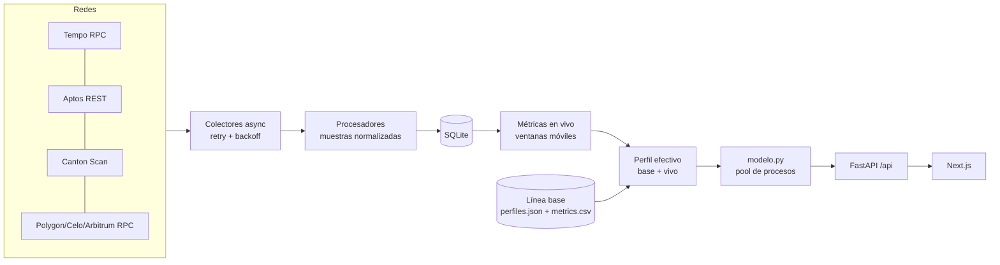
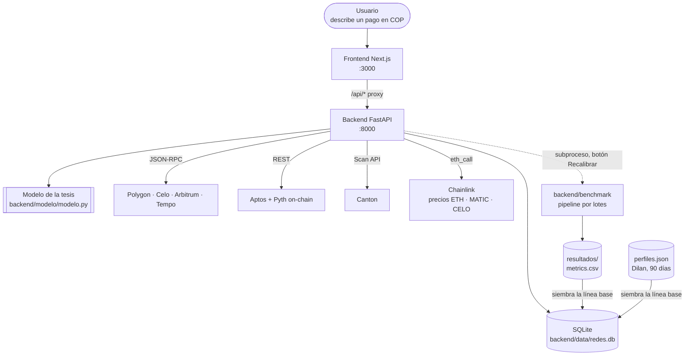
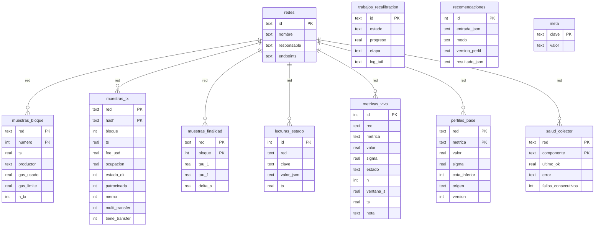

# Monitor de redes y recomendación de liquidación (Tempo, Aptos, Canton, Polygon, Celo, Arbitrum)

Proyecto de grado. Aplicación web que monitorea seis redes casi en tiempo real y recomienda en cuál liquidar un pago en pesos colombianos (remesas, comercio, alto valor), usando el modelo de decisión de la tesis. **Recomienda; no mueve fondos ni ejecuta transferencias.**

## Arranque rápido

```bash
docker compose up --build
```

Frontend en http://localhost:3000 y backend en http://localhost:8000. Es el único comando necesario (Docker con Compose); detalles, puertos y solución de problemas en [Cómo correr el proyecto (Docker)](#cómo-correr-el-proyecto-docker).

Diagrama completo de arquitectura y funcionamiento (qué métricas son en vivo, cuáles no, cómo se calculan y cómo decide el modelo): [docs/arquitectura_y_funcionamiento.mmd](docs/arquitectura_y_funcionamiento.mmd). Se abre en <https://mermaid.live> o con la extensión Mermaid de VS Code.

## Problema y objetivos

Elegir una red para liquidar un pago depende de costo, tiempo, concentración, continuidad y primitivas de pago, y esas propiedades cambian. El sistema:

1. Mide cada red con consultas reproducibles a su registro público (JSON-RPC, REST, Scan API). Nunca se completa un valor con documentación o declaraciones (regla de oro, ver [CLAUDE.md](CLAUDE.md)).
2. Normaliza las mediciones a un modelo único y las guarda en SQLite.
3. Alimenta el modelo de la tesis (`backend/modelo/modelo.py`, sin modificar) con esas mediciones.
4. Expone el resultado por una API y lo muestra en el frontend, indicando de dónde viene cada valor y qué tan fresco es.

## Funcionalidades

- Seis redes en un mismo pipeline: Polygon, Celo, Arbitrum (Dilan) y Tempo, Aptos, Canton (Jerónimo).
- Métricas en vivo (sondeo cada ~20 s) sobre ventanas móviles; lo que no se puede calcular en vivo conserva su medición base y se marca como tal.
- Recomendación por bandas, certidumbre, compuertas y métrica determinante, con procedencia por métrica (`vivo` / `base`) y edad.
- Estados explícitos: cargando, ok, dato obsoleto, datos insuficientes, error.
- Página **Monitoreo**: salud de cada colector, valor/origen/edad de cada métrica y botón **Recalibrar** para las mediciones base.
- Modo `medicion` que reproduce exactamente la tesis (solo mediciones base).

## Tecnología

| Capa | Tecnología |
|---|---|
| Backend | Python 3.11, FastAPI, uvicorn, httpx, SQLite (stdlib), pycryptodome (keccak) |
| Modelo | `backend/modelo/modelo.py` (stdlib), ejecutado en un pool de procesos |
| Frontend | Next.js 16, React 19, next-intl (es/en), Tailwind 4, vitest, pnpm |
| Pruebas | pytest (backend), vitest (frontend) |

## Arquitectura (monorepo monolítico, MVC)

### Diagrama de arquitectura (flujo de datos)



Detalle en [docs/ARCHITECTURE.md](docs/ARCHITECTURE.md).

### Diagrama de contexto



### Diagrama de la base de datos (SQLite)



`lecturas_estado` guarda lecturas puntuales (validadores, configuración, cursor de Canton, continuidad C3 acumulada, ranura de proxy). Las relaciones con `redes` son lógicas (la columna `red`), sin claves foráneas. Detalle del flujo en [docs/ARCHITECTURE.md](docs/ARCHITECTURE.md).

## Estructura

```
backend/
  app/                 FastAPI (MVC): routes/ controllers/ models/ services/ pipelines/ db/ utils/
  modelo/              modelo de la tesis + perfiles medidos (sin modificar)
  benchmark/           pipeline por lotes del benchmark Tempo/Aptos/Canton (main.py, collect_*, compute_*)
  tests/               pytest
frontend/              Next.js (src/app, src/components, src/modelo, src/lib, src/engine)
resultados/            salidas del benchmark (metrics.csv, benchmark_final.csv, raw/)
docs/                  plan, arquitectura, pipeline, modelo, redes, API, desarrollo
```

## Redes y fuentes

| Red | Responsable | Fuente | Métricas en vivo |
|---|---|---|---|
| Tempo | Jerónimo | JSON-RPC `rpc.tempo.xyz` | 14 de 16 (todas menos A4, B2b) |
| Aptos | Jerónimo | REST `api.mainnet.aptoslabs.com` | 10 (B2, C3, D2, C5 solo base) |
| Canton | Jerónimo | Scan API `api.cantonnodes.com` | 13 (D1 solo base) |
| Polygon | Dilan | JSON-RPC público | 9 (A4, B2, B2b, B3, A3, D2, D3 solo base) |
| Celo | Dilan | JSON-RPC `forno.celo.org` | 9 |
| Arbitrum | Dilan | JSON-RPC `arb1.arbitrum.io` | 9 |

La tabla completa y las razones de cada métrica solo-base están en [docs/NETWORK_INTEGRATIONS.md](docs/NETWORK_INTEGRATIONS.md).

## Pipeline casi en tiempo real

Un colector asyncio por red sondea bloques/eventos, estado (validadores, configuración) y finalidad; las muestras van a SQLite; cada 30 s se recalculan las métricas sobre sus ventanas (15 min, 24 h, 72 h, 14 d) y se invalida la caché. Una métrica en vivo solo reemplaza a la base si es `valida` (n suficiente) y fresca. Ver [docs/DATA_PIPELINE.md](docs/DATA_PIPELINE.md).

## Modelo de decisión

Metodología de la tesis (§5.4), sin cambios: interpolación de pesos entre tres escenarios, compuertas G1–G4, media geométrica por bloques, Monte Carlo con pesos Dirichlet y bandas. Ver [docs/DECISION_MODEL.md](docs/DECISION_MODEL.md).

## API

`GET /api/salud`, `/api/redes`, `/api/mediciones[/{red}]`, `/api/modelo`; `POST /api/modelo`; `POST|GET|DELETE /api/recalibracion`. Ver [docs/API.md](docs/API.md). Documentación interactiva en `http://localhost:8000/docs`.

## Variables de entorno

Todas opcionales (no se requieren claves). Lista completa en [.env.example](.env.example). Las más relevantes: `DB_PATH`, `RPC_POLYGON` (los RPC públicos de Polygon son inestables; usa un proveedor propio si hace falta), `OBSOLESCENCIA_S`, `VENTANA_*`, `BACKEND_URL` (frontend).

## Cómo correr el proyecto (Docker)

Requisito único: Docker con Compose. No se necesitan claves de API.

```bash
docker compose up --build
```

Ese comando construye las dos imágenes y levanta todo:

| Servicio | URL |
|---|---|
| Frontend | http://localhost:3000 |
| Backend (API y `/docs`) | http://localhost:8000 |

Probado: las dos imágenes compilan, el backend queda `healthy`, las seis redes responden `ok` y el frontend recomienda con datos en vivo. El backend crea su base SQLite en un volumen (`datos`), siembra la línea base y empieza a sondear las seis redes; el frontend espera a que el backend esté sano. Los datos en vivo se conservan entre reinicios.

Uso diario:

```bash
docker compose up -d --build     # en segundo plano
docker compose logs -f backend   # ver el sondeo
docker compose down              # detener (conserva los datos)
docker compose down -v           # detener y borrar la base de datos
```

Qué ver: `http://localhost:3000/es/start` (crea un usuario) → `/es/monitor` (estado de colectores y métricas en vivo/base; tras ~1 minuto ya hay datos) → `/es/transaction/new` (describe un pago y mira el resultado).

**Si `docker compose up --build` falla con `invalid file request ...` o `failed to execute bake`:** el repositorio está en OneDrive y algunos archivos son marcadores "solo en la nube" que Docker no puede leer. Fuerza su descarga local (PowerShell, desde la raíz del repo) y reintenta:

```powershell
attrib +P -U "*" /s /d
docker compose up --build
```

Si persiste el error de `bake`: `$env:COMPOSE_BAKE="false"; docker compose up --build`. Lo más estable es mover el repo fuera de OneDrive.

Si el puerto 3000 u 8000 está ocupado, cámbialo sin editar archivos: `FRONTEND_PORT=3100 BACKEND_PORT=8001 docker compose up --build` (PowerShell: `$env:FRONTEND_PORT="3100"; docker compose up --build`). Para usar otro RPC: `RPC_POLYGON=https://tu-proveedor docker compose up --build`. Sin internet: `COLECTORES_ACTIVOS=false docker compose up --build` (solo línea base).

### Sin Docker (desarrollo)

```bash
pip install -r backend/requirements.txt && cd frontend && pnpm install && cd ..
cd backend && python -m uvicorn app.main:app --port 8000     # terminal 1
cd frontend && pnpm dev                                        # terminal 2 -> http://localhost:3000
```

## Pruebas

```bash
cd backend && python -m pytest tests        # 55 pruebas
cd frontend && pnpm test && pnpm exec tsc --noEmit && pnpm lint && pnpm build
python backend/benchmark/main.py            # benchmark por lotes con resultados/raw/ (sin red)
```

## Qué funciona y qué no

**Funciona (verificado en vivo el 2026-10-19):** los seis colectores contra las redes reales; 54 de 90 métricas en vivo; recomendación en modo `vivo` y `medicion`; casos de referencia de la tesis (±0,005); monitoreo en el frontend; Recalibrar (corrida real corta completada); 55 pruebas de backend y 19 de frontend.

**No funciona o es parcial:**

| Qué | Por qué |
|---|---|
| Aptos B2, D2, C3 | Bloques de ~20 ms, definición A-5 sin fijar, muestreo sin cobertura de huecos |
| P/C/A: A3, A4, B2, B2b, B3, D2, D3 en vivo | Requieren el rastreador de anclaje en Ethereum o definiciones de la tesis no reproducibles; usan la base de 90 días |
| Recalibrar para P/C/A | No existe un colector por lotes de Dilan en este repo |
| B2 (72 h) y C3/C5 (14 d) en vivo | Solo cuentan cuando el backend lleva corriendo toda la ventana |
| Persistencia de usuarios | Solo `localStorage` del navegador; no hay cuentas ni backend de usuarios |
| RPC públicos | Pueden limitar o caer (Polygon ya cambió de proveedor) |

## Limitaciones conocidas

- **Aptos B2** no es medible por HTTP (bloques ~20 ms); **Aptos D2** necesita fijar la definición A-5; ambos quedan sin dato.
- **Polygon/Celo/Arbitrum**: A4, B2/B2b (anclaje en Ethereum), A3, B3, D2, D3 solo existen en su medición base (90 días); no hay colector por lotes para ellos en este repositorio, así que el botón Recalibrar no los cubre.
- Ventanas largas (B2 72 h, C3/C5 14 d) se llenan con el backend corriendo; mientras tanto se usa la base.
- El precio de APT en Pyth está congelado desde 2026-08-26; A1/A2 de Aptos lo usan y lo marcan.
- Canton B3 es la asignación gratuita por miembro (probablemente subestima) y se marca como cota inferior.
- Tempo/Aptos/Canton en base no tienen incertidumbre (`sigma=0`).
- Los RPC públicos tienen límites; Polygon requiere a veces cambiar de proveedor.
