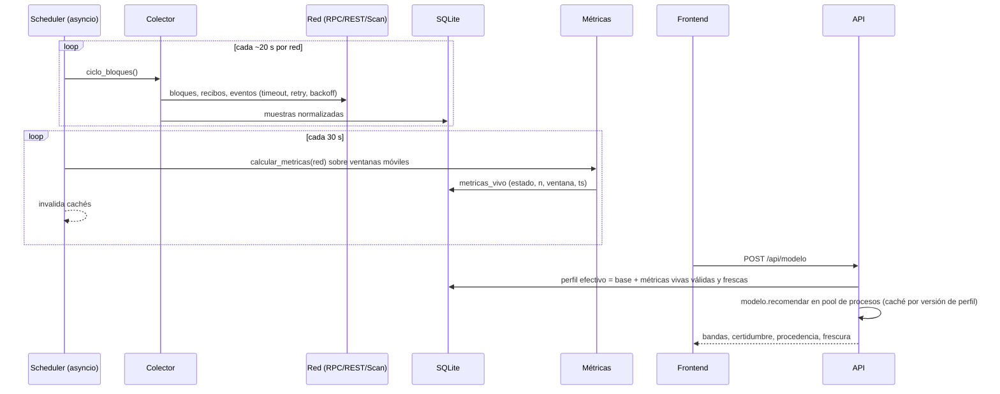

# Arquitectura

Monorepo con un backend monolítico (FastAPI) y un frontend (Next.js). No hay microservicios: el backend es un único proceso que contiene colectores, base de datos, servicios y API; el modelo de decisión corre en un pool de procesos hijos solo para no competir por el GIL.

## MVC

| Parte | Dónde | Responsabilidad |
|---|---|---|
| Modelo | `backend/app/models/`, `backend/app/db/` | Entidades (`MetricaValor`, `EstadoMetrica`, peticiones), esquema SQLite, repositorios |
| Vista | `frontend/src/app`, `frontend/src/components` | Monitoreo, resultados, estados de carga/obsoleto/vacío/error |
| Controlador | `backend/app/controllers/`, `backend/app/routes/` | Validar parámetros, llamar servicios, traducir errores a HTTP |
| Servicios (lógica) | `backend/app/services/` | `network` (registro, instantánea), `analytics` (métricas, línea base, continuidad), `decision` (perfil efectivo, recomendador), `recalibracion` |
| Pipelines | `backend/app/pipelines/` | `collectors` (E/S de red), `processors` (payload → muestra normalizada), `validators`, `scheduler` |

El contenedor `backend/app/container.py` es el único lugar donde se ensamblan las piezas.

## Flujo

## Decisiones de diseño

- **SQLite (WAL)** como fuente de verdad; la caché en memoria (`utils/cache.py`, TTL + LRU) solo evita recalcular. La clave de la caché de recomendaciones incluye `version_perfil` (hash del perfil efectivo), así que un dato nuevo invalida resultados viejos sin lógica extra.
- **Perfil efectivo**: la línea base (`perfiles_base`) se sobrescribe por métrica con el valor vivo solo si `estado=valida` y su edad < `OBSOLESCENCIA_S` (15 min; 2 h para lecturas de estado). Si no, cae a la base y la respuesta lo dice.
- **`modelo.py` no se toca** (contrato de `backend/modelo/INTEGRACION.md`). El modo `medicion` reproduce los casos de referencia de la tesis.
- **Continuidad incremental**: C3 se acumula por ciclo (conteo, suma, mediana, huecos grandes) en `lecturas_estado`, para sostener 14 días sin guardar cada bloque.
- **Sin solapamiento**: un candado por (red, componente); los fallos aplican backoff (hasta 8×) y quedan en `salud_colector`.
- **Recomendar ≠ ejecutar**: ninguna ruta mueve fondos.

## Esquema SQLite

`muestras_bloque`, `muestras_tx`, `muestras_finalidad`, `lecturas_estado`, `metricas_vivo`, `perfiles_base`, `salud_colector`, `trabajos_recalibracion`, `recomendaciones`, `redes`, `meta`. Migraciones en `backend/app/db/migrations.py` (`PRAGMA user_version`). La poda por retención corre cada hora.
