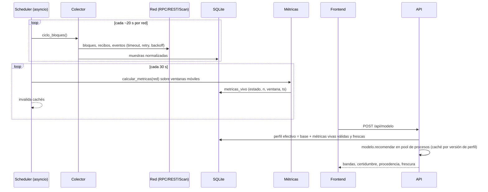

# Arquitectura

Monorepo con un backend monolítico (FastAPI) y un frontend (Next.js). No hay microservicios: el backend es un único proceso que contiene colectores, base de datos, servicios y API; el modelo de decisión corre en un pool de procesos hijos solo para no competir por el GIL. La aplicación **solo recomienda**: ninguna ruta ejecuta ni mueve fondos.

Otros documentos: [DATA_PIPELINE.md](DATA_PIPELINE.md) (de dónde sale cada dato) · [MODELO.md](MODELO.md) (cómo se decide y cómo se prueba) · [../resultados/limitaciones.md](../resultados/limitaciones.md).

## Estructura del repositorio

```
backend/app/         FastAPI: routes/ -> controllers/ -> services/ ; pipelines/{collectors,processors,validators,scheduler} ; db/ ; models/ ; utils/
backend/modelo/      modelo de la tesis (modelo.py, perfiles.json, casos_referencia.json). No se edita
backend/benchmark/   pipeline por lotes de Tempo, Aptos y Canton y el informe unificado de las seis redes
backend/simulacion/  banco de usuarios simulados (P1-P7) y publicación de sus resultados
backend/tests/       pytest
frontend/src/        Next.js: app/[locale]/*, components/, modelo/ (cliente y tipos del backend), lib/, engine/, state/
resultados/          benchmark.md/.html, pruebas.md/.html, limitaciones.md, CSV del benchmark, raw/ y pruebas/datos/
docs/                estos tres documentos
```

Las seis redes: Polygon, Celo y Arbitrum (Dilan) y Tempo, Aptos y Canton (Jerónimo).

## MVC

| Parte | Dónde | Responsabilidad |
|---|---|---|
| Modelo | `backend/app/models/`, `backend/app/db/` | Entidades (`MetricaValor`, `EstadoMetrica`, peticiones), esquema SQLite, repositorios |
| Vista | `frontend/src/app`, `frontend/src/components` | Monitoreo, asistente de pago, resultados, simulación; estados de carga, obsoleto, vacío y error |
| Controlador | `backend/app/controllers/`, `backend/app/routes/` | Validar parámetros, llamar servicios, traducir errores a HTTP |
| Servicios (lógica) | `backend/app/services/` | `network` (registro, instantánea, integraciones), `analytics` (métricas, línea base, continuidad), `decision` (perfil efectivo, recomendador), `recalibracion` |
| Pipelines | `backend/app/pipelines/` | `collectors` (E/S de red), `processors` (payload → muestra normalizada), `validators`, `scheduler` |

El contenedor `backend/app/container.py` es el único lugar donde se ensamblan las piezas. Puntos de entrada: `backend/app/main.py` (ciclo de vida), `backend/app/pipelines/scheduler.py` (sondeo), `backend/app/services/decision/recomendador.py` (modelo) y `frontend/src/modelo/cliente.ts` (consumo de la API).

## Flujo



## Decisiones de diseño

- **SQLite (WAL)** como fuente de verdad; la caché en memoria (`utils/cache.py`, TTL + LRU) solo evita recalcular. La clave de la caché de recomendaciones incluye `version_perfil` (hash del perfil efectivo): un dato nuevo invalida resultados viejos sin lógica extra.
- **Perfil efectivo**: la línea base (`perfiles_base`) se sobrescribe por métrica con el valor vivo solo si `estado=valida` y su edad < `OBSOLESCENCIA_S` (15 min; 2 h para lecturas de estado). Si no, cae a la base y la respuesta lo dice. El modo `medicion` usa solo la base y reproduce los casos de referencia de la tesis.
- **`modelo.py` no se toca** (contrato en `backend/modelo/INTEGRACION.md`). Se cambian los datos (perfiles) o se añade lógica alrededor en `services/decision/`; cualquier cambio de pesos, umbrales o fórmulas es una decisión de tesis, no de código.
- **Continuidad incremental**: C3 se acumula por ciclo (conteo, suma, mediana, huecos grandes) en `lecturas_estado`, para sostener 14 días sin guardar cada bloque.
- **Sin solapamiento**: un candado por (red, componente); los fallos aplican backoff (hasta 8×) y quedan en `salud_colector`.
- **Nada simulado en la aplicación**: lo que falta se muestra como falta (`null`, `insuficiente`, `no_computable`). El banco de usuarios simulados vive aparte y escribe solo en `simulacion.db`.
- **Convenciones**: cada archivo lleva solo un comentario o docstring de cabecera que dice qué hace; la lógica no va en controladores ni en rutas.

## Esquema SQLite

`muestras_bloque`, `muestras_tx`, `muestras_finalidad`, `lecturas_estado`, `metricas_vivo`, `perfiles_base`, `salud_colector`, `trabajos_recalibracion`, `recomendaciones`, `redes`, `meta`. Migraciones en `backend/app/db/migrations.py` (`PRAGMA user_version`). La poda por retención corre cada hora. La base está en `backend/data/redes.db` (en Docker, el volumen `datos`).

## Cómo añadir una red

1. Procesador en `pipelines/processors/` (payload → muestra con los campos de `muestras_bloque`, `muestras_tx` o `muestras_finalidad`).
2. Colector en `pipelines/collectors/` (subclase de `Colector`; `ciclo_bloques`, opcional `ciclo_estado` o `ciclo_finalidad`); se registra en `Contenedor._construir_colectores`.
3. Función `calcular_<red>` en `services/analytics/metricas.py` y su rama en `calcular_metricas`.
4. Entrada en `services/network/registry.py` (métricas vivas y razón de cada solo-base) y en `Settings` (endpoint).
5. Línea base: perfil en `perfiles.json` o `metrics.csv`, o una conversión en `services/analytics/baseline.py`.
6. Etiqueta en `frontend/src/lib/format.ts` (`NETWORK_LABEL`), `networks.<id>.desc` en `frontend/messages/{es,en}.json` y el id en `frontend/src/engine/types.ts` (`NETWORK_IDS`). El modelo y las páginas no cambian.

## Contenedores y ejecución local

`docker-compose.yml` levanta dos servicios: `backend` (FastAPI en el puerto 8000, volumen `datos` en `/app/backend/data`, healthcheck en `/api/salud`) y `frontend` (Next.js en el 3000; reenvía `/api/*` a `http://backend:8000`, fijado al construir porque `next.config.ts` lo lee en las rewrites). Una sola réplica: SQLite y los colectores no admiten varias. El directorio `certs/` aporta CAs extra si una red intercepta HTTPS. Los pasos de ejecución están en el [README](../README.md).

## Configuración

Todas las variables son opcionales (ver `.env.example`): endpoints por red (`RPC_*`, `REST_APTOS`, `SCAN_CANTON`), Ethereum para el anclaje (`RPC_ETHEREUM`, `VENTANA_ANCLAJE_S`), intervalos y ventanas (`INTERVALO_*`, `VENTANA_*`, `OBSOLESCENCIA_S`), `REPLICAS_MONTE_CARLO`, `COLECTORES_ACTIVOS`, `APTOS_API_KEY` (sube el límite anónimo de Aptos) y las del banco de simulación (`SIMULACION_TOKEN`, `SIM_*`). Con `COLECTORES_ACTIVOS=false` la aplicación usa solo la línea base.

## API

Backend en `http://localhost:8000`; documentación interactiva en `/docs`. El frontend la consume como `/api/*`. Errores: `{"error": "mensaje"}`; una petición inválida devuelve `400` con `{"error": "peticion invalida", "detalle": [...]}`.

| Método | Ruta | Descripción |
|---|---|---|
| GET | `/api/salud` | Estado de base de datos, monitor y colectores por red |
| GET | `/api/redes` | Las seis redes: responsable, fuente, métricas en vivo y solo-base con su razón |
| GET | `/api/mediciones` | Instantánea de todas las redes (caché ≤ 30 s) |
| GET | `/api/mediciones/{red}` | Una red y series cortas de sus métricas vivas (`404` si no existe) |
| GET | `/api/modelo` | Descripción del modelo: redes, umbrales, escenarios, versión y frescura |
| POST | `/api/modelo` | `interpretar` o `recomendar` |
| POST / GET / DELETE | `/api/recalibracion` | Inicia (`409` si hay una en curso), consulta o cancela la recalibración |
| GET | `/api/integraciones` | Verifica en vivo las fuentes externas (RPC, Aptos, Canton, Pyth, Chainlink) con latencia y error exacto |
| GET | `/api/simulacion` | Estado del último lote y del panel continuo |
| GET | `/api/simulacion/resultados` | Resultados en JSON del último lote y serie del panel (los consume la página Simulación) |
| POST / DELETE | `/api/simulacion/lote` | Lanza (`202`) o cancela las pruebas P1-P6 |
| POST / DELETE | `/api/simulacion/continuo` | Inicia o detiene el panel continuo P7 |
| POST | `/api/simulacion/informe` | Regenera informe y CSV desde la base |
| GET | `/api/simulacion/archivos[/{nombre}]` | Lista o descarga informe, CSV y manifiesto |

`POST`/`DELETE` de `/api/simulacion/*` exigen `Authorization: Bearer $SIMULACION_TOKEN` solo si la variable está definida; en local, sin token, quedan abiertos.

### POST /api/modelo

```json
{ "accion": "recomendar", "monto_cop": 1200000, "transfronterizo": true, "espera_s": 3600,
  "irrevocabilidad": "baja", "trm": 4000, "modo": "vivo" }
```

`accion`: `recomendar` (defecto) o `interpretar` (solo composición y certidumbre, sin Monte Carlo). `modo`: `vivo` (defecto) o `medicion`. Límites: `monto_cop` ∈ (0, 1e13], `espera_s` ∈ (0, 1e7], `trm` ∈ (0, 1e6]. La respuesta trae `estado` (`ok`, `datos_insuficientes` o `sin_redes_admisibles`), `resultado` (salida de `modelo.recomendar` sin cambios), `nivel_certidumbre`, `detalle` por red (métricas con puntaje y procedencia, bloques, compuertas), `procedencia`, `frescura`, `version_perfil`, `modo`, `decidido_en`, `trm` y `redes_sin_datos`. Con `datos_insuficientes`, `resultado` es `null`.

### GET /api/mediciones

Devuelve `generado_en`, `version_perfil`, `frescura`, `obsolescencia_s` y, por red, `salud` (`ok`, `degradada`, `caida` o `sin_datos`, con sus componentes), `muestras` y `metricas` con `valor`, `origen` (`vivo`, `base` o `null`), `edad_s`, `n`, `ventana_s`, el estado vivo (`valida`, `insuficiente`, `obsoleta`, `fallida`, `no_computable`) y `razon_solo_base`.

### Recalibración

`POST` acepta `{ "redes": [...], "bloques_tempo": 50, "bloques_aptos": 20, "paginas_canton": 2, "minutos_evm": 10 }`, todo opcional (`redes` vacío = las seis). Tempo, Aptos y Canton recalibran su línea base; Polygon, Celo y Arbitrum rellenan `minutos_evm` (5 a 1440) de su ventana en vivo sin tocar su línea base de 90 días. El trabajo corre en un directorio aislado (`backend/data/recalibracion/<id>/`) y nunca toca `resultados/`.

### Banco de simulación

El cuerpo de `POST /api/simulacion/lote` es opcional: `{ "pruebas": ["P1".."P6"], "fuente": "base|vivo|ambas", "semilla", "replicas": 100-100000, "tope": 50-400, "panel_por_perfil": 1-50, "niveles_replicas": [500, 2000, 10000, 40000] }`. Descripción de las pruebas en [MODELO.md](MODELO.md).

## Integraciones por red

La tabla de qué métrica es en vivo y cuál solo existe en la línea base vive en código (`backend/app/services/network/registry.py`) y `GET /api/redes` la expone.

| Red | Fuente | Colector |
|---|---|---|
| Polygon PoS | JSON-RPC `polygon.publicnode.com` | EVM (bloques, pagos USDC, precio Chainlink MATIC/USD, anclaje en Ethereum) |
| Celo | JSON-RPC `forno.celo.org` | EVM |
| Arbitrum One | JSON-RPC `arb1.arbitrum.io/rpc` | EVM |
| Tempo | JSON-RPC `rpc.tempo.xyz` | Continuo, con finalidad en vivo |
| Aptos | REST `api.mainnet.aptoslabs.com/v1` | Por muestreo (precio de APT desde Pyth on-chain) |
| Canton | Scan API `api.cantonnodes.com` | Con cursor persistido |

Cada identificador (USDC, feeds de Chainlink y Pyth, selectores y topics) se verifica en vivo o se calcula con keccak256; ninguno se copia de memoria ni de documentación. Los precios USD salen del registro de cada red (Chainlink en cadena, Pyth en Aptos); Hermes de Pyth ya no sirve precios sin clave y el Pyth on-chain de EVM está obsoleto, así que no se usan. La matriz métrica × red y los tiempos hasta que una métrica es válida están en [DATA_PIPELINE.md](DATA_PIPELINE.md).

Diferencias metodológicas: Tempo, Aptos y Canton en base usan `sigma = 0` y las métricas vivas traen error estándar por bootstrap; Canton B2 en vivo es la mediana mientras la base de `metrics.csv` usa el p95 (discrepancia heredada del benchmark); los RPC públicos son inestables y se configuran con `RPC_*`; el API anónimo de Aptos cobra por tamaño de respuesta (40 000 unidades cada 300 s por IP), así que no deben correr dos recolecciones de Aptos a la vez desde la misma IP.

## Frontend

Next.js con rutas bajo `app/[locale]/` (`es` y `en`, textos en `frontend/messages/`): `home`, `monitor` (estado de las seis redes), `transaction/new` y `transaction/analyzing` (asistente de pago), `result/[id]` y `result/[id]/[network]` (recomendación y detalle por red), `history`, `standard`, `onboarding` y `simulation` (solo lectura; consume `/api/simulacion/resultados` y se actualiza sola). `frontend/src/modelo/` contiene el cliente y los tipos del backend; `frontend/src/engine/` solo tipos y constantes de visualización.
