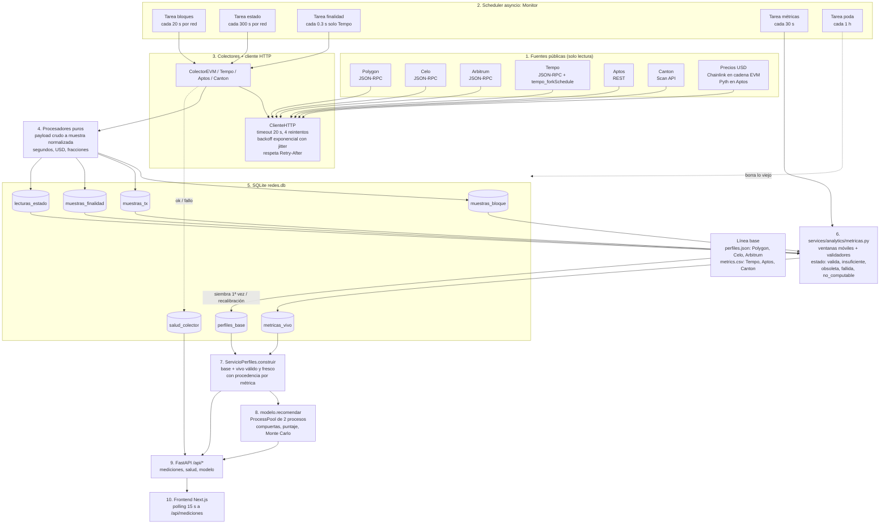
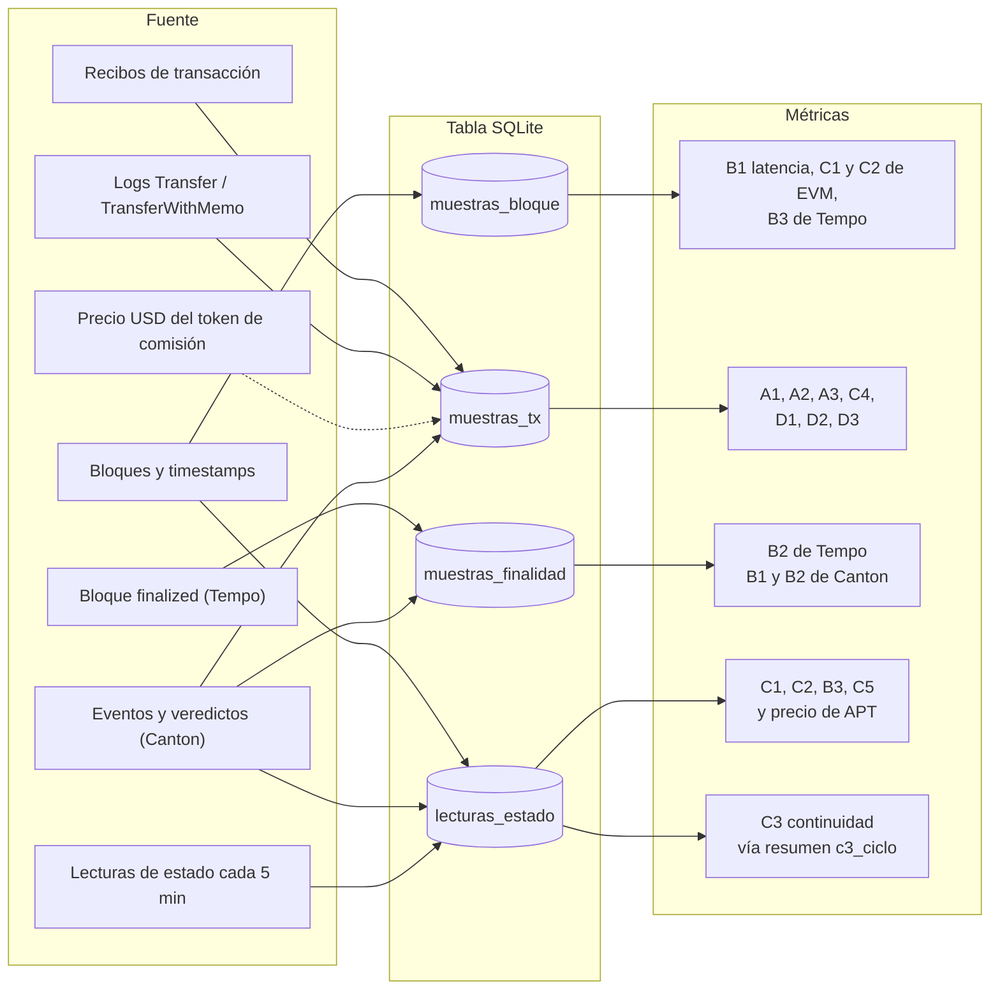
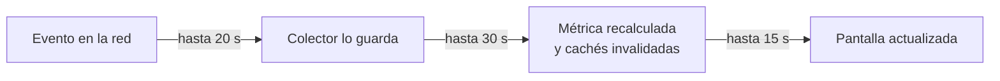
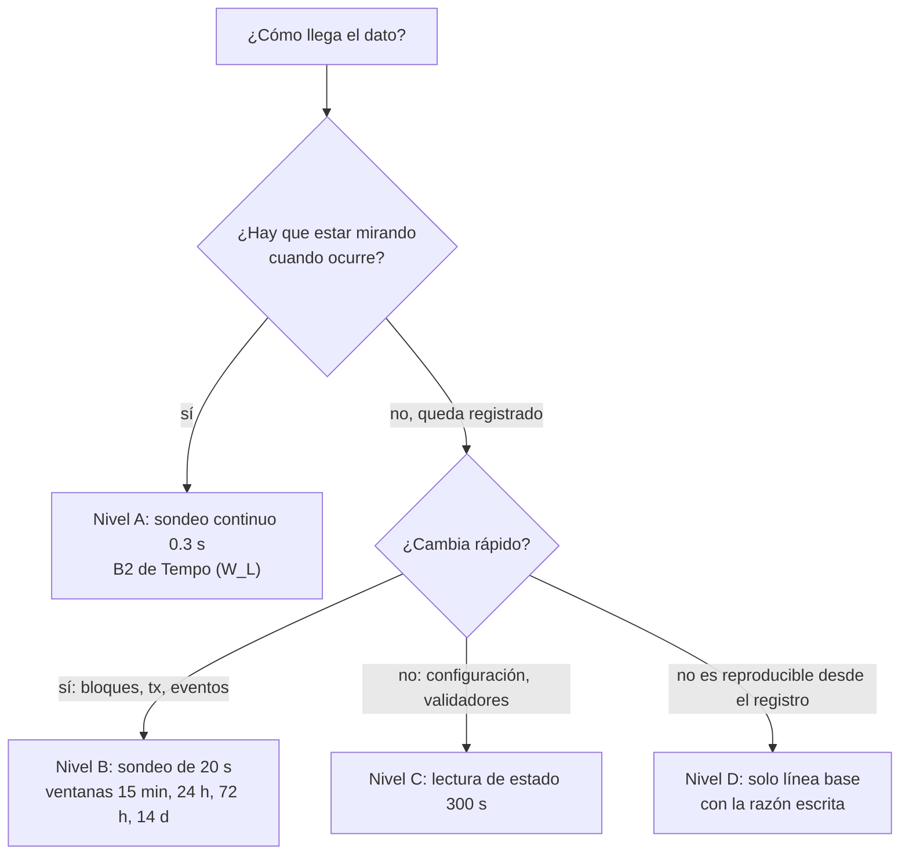
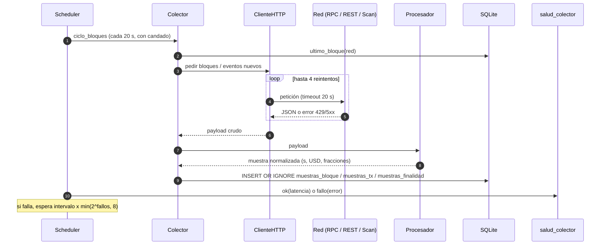
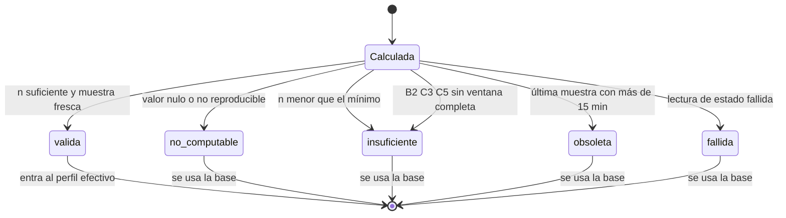
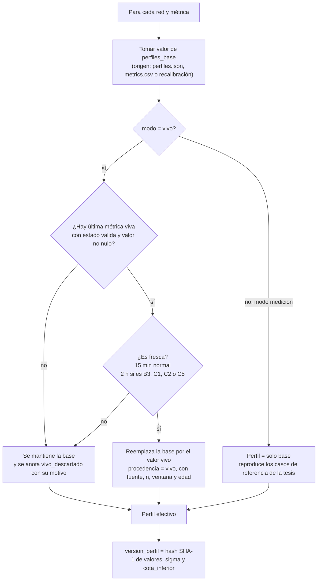
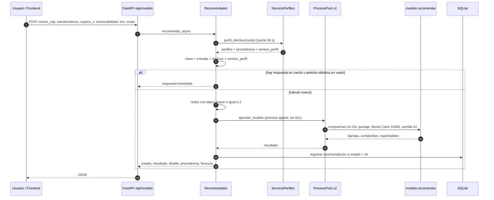

# Pipeline de datos casi en tiempo real

Referencia completa de cómo la aplicación obtiene los datos de las seis redes (Polygon, Celo, Arbitrum, Tempo, Aptos y Canton), cada cuánto los toma, cómo los valida y los convierte en métricas, y cómo llegan al modelo de decisión y a la interfaz. Incluye la matriz de qué métrica sale de dónde en cada red, y cuánto tarda en ser "viva".

Documentos relacionados: [ARCHITECTURE.md](ARCHITECTURE.md) · [DECISION_MODEL.md](DECISION_MODEL.md) · [NETWORK_INTEGRATIONS.md](NETWORK_INTEGRATIONS.md) · [API.md](API.md).

## Contenido

1. [Principios](#1-principios)
2. [Mapa general](#2-mapa-general)
3. [Componentes](#3-componentes)
4. [Frecuencias, ventanas y latencia](#4-frecuencias-ventanas-y-latencia)
5. [Qué es tiempo real y qué no](#5-qué-es-tiempo-real-y-qué-no)
6. [Recolección por red](#6-recolección-por-red)
7. [Normalización y almacenamiento](#7-normalización-y-almacenamiento)
8. [Fallos y recuperación](#8-fallos-y-recuperación)
9. [Cálculo de métricas](#9-cálculo-de-métricas)
10. [Estados de una métrica y ventanas completas](#10-estados-de-una-métrica-y-ventanas-completas)
11. [Línea base + vivo = perfil efectivo](#11-línea-base--vivo--perfil-efectivo)
12. [Del perfil al modelo y a la pantalla](#12-del-perfil-al-modelo-y-a-la-pantalla)
13. [Recalibración](#13-recalibración)
14. [Matriz métrica × red](#14-matriz-métrica--red)
15. [Matriz de fuentes, cadencia y tiempo hasta ser válida](#15-matriz-de-fuentes-cadencia-y-tiempo-hasta-ser-válida)
16. [Identificadores verificados](#16-identificadores-verificados)
17. [Diferencias metodológicas y limitaciones](#17-diferencias-metodológicas-y-limitaciones)

---

## 1. Principios

- **Solo registros públicos.** Cada dato sale de una consulta reproducible al registro que la propia red publica (JSON-RPC de Tempo y EVM, REST de Aptos, Scan API de Canton, feeds on-chain de precio). Nunca de documentación, blogs o declaraciones de equipos.
- **Nada simulado.** Lo que falta se muestra como falta: `null`, `insuficiente`, `no_computable`, con su razón.
- **Cada identificador se verifica** en vivo o se calcula con keccak (ver [§16](#16-identificadores-verificados)).
- **Procedencia visible.** Cada número del perfil dice si es `base` o `vivo`, de qué fuente, con qué `n`, ventana y edad.
- **Casi tiempo real = sondeo periódico (polling).** Ninguna red empuja eventos; la aplicación pregunta cada cierto tiempo.
- **Solo recomienda.** No ejecuta transferencias.

---

## 2. Mapa general

Los pasos 2 a 6 corren solos en segundo plano desde que arranca el servidor (`lifespan` de FastAPI → `Contenedor.iniciar()` → siembra de la base → precalentamiento del pool → `Monitor.iniciar()`). Los pasos 7 a 10 se activan cuando alguien abre la interfaz o pide una recomendación.

### 2.1 Familias de dato: de la fuente a las métricas

---

## 3. Componentes

| Pieza | Archivo | Qué hace |
|---|---|---|
| Cliente HTTP | `pipelines/collectors/base.py` | Timeout, reintentos con backoff exponencial + jitter (429/5xx/red), respeta `Retry-After`, no reintenta 4xx, JSON-RPC y lotes. Usa el almacén de certificados del SO |
| Colectores | `pipelines/collectors/{evm,tempo,aptos,canton}.py` | `ciclo_bloques`, `ciclo_estado`, `ciclo_finalidad` por red |
| Precios | `pipelines/collectors/precios.py` | Chainlink en cadena (ETH/Arbitrum, MATIC-POL/Polygon, CELO/Celo) y Pyth on-chain (APT/Aptos). Cada dirección se verifica en vivo (`description()`, `decimals()`, frescura < 1 h) |
| Procesadores | `pipelines/processors/*.py` | Payload crudo → muestra normalizada (segundos, USD, fracciones). Funciones puras |
| Validadores | `pipelines/validators/validadores.py` | Rangos, unidades, estado de la métrica (`valida`/`insuficiente`/`obsoleta`) |
| Scheduler | `pipelines/scheduler.py` | Tareas asyncio, sin solapamiento, backoff, apagado limpio |
| Métricas | `services/analytics/metricas.py`, `continuidad.py` | Muestras → `MetricaValor` por ventana |
| Perfil efectivo | `services/decision/perfiles.py` | Base + métricas vivas válidas y frescas, con procedencia |
| Recomendador | `services/decision/recomendador.py` | Envuelve `modelo.py`; caché, pool de procesos, estados explícitos |
| Instantánea | `services/network/snapshot.py` | Une perfil efectivo, última métrica viva y salud del colector para la vista Monitoreo |
| Registro de redes | `services/network/registry.py` | Qué métricas son vivas y por qué cada una de las demás es solo base |
| Recalibración | `services/recalibracion/trabajos.py` | Corre el benchmark por lotes en un subproceso aislado |

### 3.1 Tablas de SQLite (`db/migrations.py`)

| Tabla | Contenido | Llave |
|---|---|---|
| `muestras_bloque` | `numero, ts, productor, gas_usado, gas_limite, n_tx, fuente` | `(red, numero)` |
| `muestras_tx` | `hash, bloque, ts, fee_usd, precio_usado, ocupacion, gas_usado, estado_ok, patrocinada, memo, multi_transfer, multi_activo, tiene_transfer` | `(red, hash)` |
| `muestras_finalidad` | `bloque, tau_1, tau_f, delta_s` | `(red, bloque)` |
| `lecturas_estado` | lecturas puntuales con hora (`clave`, `valor_json`, `ts`): validadores, config, cursor, `c3_ciclo`, `c5_cambios`… | historial por `(red, clave, ts)` |
| `metricas_vivo` | cada cálculo: `valor, sigma, unidad, estado, n, ventana_s, fuente, nota, cota_inferior` | historial; se lee la última por `(red, métrica)` |
| `perfiles_base` | línea base por red y métrica, con `origen` y `version` | `(red, metrica)` |
| `salud_colector` | `ultimo_ok, ultimo_error, error, latencia_ms, fallos_consecutivos` | `(red, componente)` |
| `trabajos_recalibracion`, `recomendaciones`, `redes`, `meta` | recalibración, auditoría de recomendaciones, catálogo, versión de la base | — |

Las inserciones de muestras usan `INSERT OR IGNORE`: repetir una lectura nunca duplica.

---

## 4. Frecuencias, ventanas y latencia

Todo es configurable por variables de entorno (`backend/app/config.py`). Valores por defecto:

| Qué | Por defecto | Variable |
|---|---|---|
| Bloques/eventos | cada **20 s** (máx. 40 bloques por ciclo; Aptos 6; Canton hasta 10 páginas) | `INTERVALO_BLOQUES_S`, `MAX_BLOQUES_POR_CICLO`, `BLOQUES_APTOS_POR_CICLO`, `CANTON_PAGINAS_POR_CICLO` |
| Estado (validadores, config, ranura de proxy) | cada **300 s** | `INTERVALO_ESTADO_S` |
| Finalidad Tempo | cada **0,3 s** (continuo) | `INTERVALO_FINALIDAD_S` |
| Cálculo de métricas | cada **30 s** | `INTERVALO_METRICAS_S` |
| Poda | cada **1 h** | — |
| Caché de precios | **60 s** | — |
| Caché de perfil/instantánea | **30 s** (se invalida en cada cálculo de métricas) | `CACHE_TTL_S` |
| Frontend | **15 s** a `/api/mediciones`; 60 s a `/api/modelo` (info); recalibración 3 s activa, 20 s en reposo | `REFRESCO_MEDICIONES_MS` |
| Ventanas | flujo **15 min** · distribución **24 h** · finalidad **72 h** · continuidad **14 d** | `VENTANA_*_S` |
| Obsolescencia | **15 min** (métricas), **2 h** (lecturas de estado: B3, C1, C2, C5) | `OBSOLESCENCIA_S`, `OBSOLESCENCIA_ESTADO_S` |

### 4.1 Reglas del scheduler

- **Escalonado:** las redes arrancan desfasadas `i × 1,5 s` (el estado, la mitad) para no golpear todos los RPC a la vez. La finalidad de Tempo arranca a los 3 s.
- **Sin solapamiento:** cada par `(red, componente)` tiene un candado; si el ciclo anterior sigue corriendo, el nuevo se salta.
- **Backoff por componente:** tras un fallo espera `intervalo × min(2^fallos, 8)`; un éxito reinicia el contador.
- **Cálculo de métricas** en un hilo aparte (`asyncio.to_thread`); primera ejecución a los ≤ 10 s del arranque.
- **Apagado limpio:** todas las tareas se cancelan y se espera su cierre.

### 4.2 Latencia de punta a punta (peor caso)

| Tipo de dato | Retardo máximo hasta pantalla |
|---|---|
| Bloques, transacciones, eventos | ≈ 20 + 30 + 15 = **~65 s** |
| Lecturas de estado (validadores, config, precio APT, DSO) | ≈ 300 + 30 + 15 = **~345 s** |
| Finalidad de Tempo | ≈ 0,3 + 30 + 15 = **~45 s** (resolución de medición ≈ 0,3 s + latencia de red) |

Estos retardos son cálculos a partir de los intervalos configurados, no mediciones. Además, una métrica en vivo solo reemplaza a la base si es válida y fresca (ver [§11](#11-línea-base--vivo--perfil-efectivo)).

### 4.3 Muestreo

Las redes rápidas no se leen completas: si el sondeo se atrasa más que el tope, se toman los bloques más recientes y se registran los saltados. Consecuencias documentadas en cada métrica:

- B1 usa solo pares de bloques consecutivos.
- C3 exige cobertura ≥ 0,9 de pares; si no (Aptos, Arbitrum) queda `no_computable` y se usa la base.
- C1/C2 de Polygon/Celo/Arbitrum son sobre la muestra de bloques, no un censo.
- Canton guarda 1 de cada 4 veredictos (`CANTON_SUBMUESTREO`); A3 escala el tráfico por ese factor.
- En el primer arranque EVM y Tempo toman solo los 10 bloques más recientes.

---

## 5. Qué es tiempo real y qué no

Hay cuatro niveles, de más a menos "vivo".

### Nivel A: sondeo continuo (el único realmente "tiempo real")

| Métrica | Red | Cómo |
|---|---|---|
| **B2 finalidad** (τF − τ1) | **Tempo** | cada 0,3 s pide `eth_getBlockByNumber("finalized")`. Cuando el número cambia guarda `tau_f` = hora en que se vio y `tau_1` = timestamp del bloque |

Se necesita sondeo porque la finalidad no deja un evento posterior que la registre. **Aptos B2 no es medible por HTTP:** los bloques (~20 ms) son más rápidos que un round-trip.

### Nivel B: casi tiempo real, sondeo de 20 s con ventanas móviles

| Ventana | Métricas |
|---|---|
| **Flujo, 15 min** | B1 de EVM, Tempo y Aptos |
| **Distribución, 24 h** | A1, A2, A3, C4, D1, D2, D3, B3 de Tempo; C1/C2 de EVM; B1/B2 de Canton |
| **Finalidad, 72 h** | B2 de Tempo |
| **Continuidad, 14 días** | C3 (huecos) y C5 (cambios) |

### Nivel C: lecturas de estado cada 5 min

| Dato | Red | Alimenta |
|---|---|---|
| `ValidatorConfigV2.getActiveValidators()` | Tempo | C1, C2 |
| `tempo_forkSchedule` | Tempo | C5 |
| `0x1::stake::ValidatorSet` | Aptos | C1, C2 |
| `0x1::execution_config::ExecutionConfig` (BCS) | Aptos | B3 |
| Precio APT/USD (Pyth on-chain) | Aptos | A1, A2 |
| `GET /v0/dso` | Canton | C1, C2, B3 |
| Ranura de implementación del proxy de USDC | Polygon, Celo, Arbitrum | C5 |
| Verificación del contrato USDC | Polygon, Celo, Arbitrum | validez del token de pago |

### Nivel D: solo línea base

Razones exactas (tomadas de `services/network/registry.py`, que también las muestra la interfaz como `razon_solo_base`):

| Red | Métrica | Razón |
|---|---|---|
| Polygon, Celo, Arbitrum | A3 | la regresión de la tesis exige ajuste con R² suficiente; la línea base la reporta no concluyente |
| | A4, B2, B2b | requieren el rastreador de anclaje en Ethereum (contratos de checkpoint verificados); no reproducible hoy |
| | B3 | caudal sostenido de una hora sobre 90 días; no reproducible con una ventana corta |
| | D2, D3 | la definición estricta de la tesis no es reproducible desde recibos |
| Aptos | B2 | bloques de ~20 ms más rápidos que un round-trip HTTP (D1 del plan) |
| | C3 | el muestreo no cubre los pares consecutivos necesarios (cobertura < 0,9) |
| | D2 | definición de referencia apta (A-5) sin fijar por escrito; muestra dominada por trading de derivados |
| | C5 | la definición del benchmark (publicaciones de módulos de cualquier cuenta) no mide mutabilidad de la ruta de pago |
| Canton | D1 | sujeto declarado: no aplica por arquitectura |
| Tempo | — | las 14 métricas del catálogo se miden en vivo |

---

## 6. Recolección por red

### 6.1 Ciclo de un colector

### 6.2 EVM: Polygon, Celo y Arbitrum (`collectors/evm.py`)

1. **Verifica el USDC** una vez: `symbol() == "USDC"`, `decimals() == 6`, `eth_getCode` no vacío. Si no cuadra, el colector falla.
2. `eth_blockNumber` → rango (continúa desde el último guardado, máx. 40; en el primer arranque, 10).
3. `eth_getBlockByNumber(n, true)` en **lotes de 10** → muestra de bloque (timestamp, productor = `miner`, gas, ocupación).
4. `eth_getLogs` del evento `Transfer` del contrato USDC en el rango.
5. **Candidatas a pago:** transacciones dirigidas al USDC *o* cuyo hash aparece en un log `Transfer`.
6. `eth_getTransactionReceipt` en **lotes de 25** → `tx_de_pago_evm`: costo = `(gasUsed × effectiveGasPrice + l1Fee) / 1e18 × precio_nativo`; `tiene_transfer` (con éxito), `estado_ok`, `patrocinada` (EIP-3009, EIP-7702, ERC-4337 o `feeCurrency`).
7. **Precio nativo** desde Chainlink: ETH en Arbitrum, MATIC/POL en Polygon, CELO en Celo. Si falla, `fee_usd` queda nulo (nunca un valor inventado). Si la transacción paga en `feeCurrency`, también nulo.
8. **Estado (300 s):** lee las ranuras de implementación del proxy de USDC (`zeppelinos` y `eip1967`) con `eth_getStorageAt`; el historial de implementaciones alimenta C5.

### 6.3 Tempo (`collectors/tempo.py`)

- **Bloques (20 s):** igual que EVM, pero trae **todas** las transacciones y recibos en lotes de 25 (en Tempo todo es pago TIP-20). El productor viene de `consensusContext.proposer`; el timestamp suma `timestampMillisPart`.
  - Costo en USD = `gasUsed × effectiveGasPrice / 1e18`, solo si el `feeToken` se verificó (`decimals()` entre 1 y 18); precio fijado en 1,0 por ser token de comisión en dólares.
  - Detecta `feePayer` (D1), evento `TransferWithMemo` (D2) y varias transferencias/activos (D3).
- **Estado (300 s):** validadores activos del precompilado `0xCCCCCCCC00000000000000000000000000000001` (`getActiveValidators()`) y `tempo_forkSchedule`.
- **Finalidad (0,3 s):** ver Nivel A. Solo registra cuando el bloque `finalized` cambia, y descarta transiciones con `t_obs < tau_1`.

### 6.4 Aptos (`collectors/aptos.py`)

- **Bloques (20 s):** `GET /` para la altura; luego `blocks/by_height/{h}?with_transactions=true` **en paralelo** para 6 alturas. Resuelve el activo de cada `FungibleStore` (para D3). Costo = `gas_used × gas_unit_price / 1e8 × precio_APT`. Ocupación = gas del bloque / límite efectivo de `ExecutionConfig`.
- **Estado (300 s):** decodifica el blob BCS de `ExecutionConfig` (se exige consumir todos los bytes), lee `ValidatorSet` (pesos de voto) y el precio de Pyth.
- **Pyth:** el feed ID se resuelve con la API de Hermes y se **verifica contra la tabla on-chain** (el `price_identifier` devuelto debe coincidir). Si el precio lleva más de 24 h sin actualizarse se marca **congelado** y la nota de A1/A2 lo indica. Hoy está congelado desde 2026-08-26.

### 6.5 Canton (`collectors/canton.py`)

- No hay bloques: hay un **flujo de eventos** (`POST /v0/events`, páginas de 200, hasta 10 por ciclo, pausa de 0,2 s) con un **cursor persistido** en SQLite (`cursor_eventos`); un reinicio retoma donde quedó. Cursor inicial: hace 60 s. Si no hay eventos y el cursor tiene más de 10 min, prueba con `migration_id + 1`.
- De cada evento se extrae:
  - **Veredicto:** latencia `finalization_time − record_time`, costo de tráfico (`total_traffic_cost`), si fue rechazado. Solo 1 de cada 4 se conserva.
  - **Transferencia** (`TransferFactory_Transfer`, `AmuletRules_Transfer`): `meta` (D2), salidas múltiples (D3), instrumentos.
  - **Latido** `ValidatorLicense_ReportActive` (C3).
  - **Cambios estructurales** `DsoRules_*` no rutinarios (C5).
- **Estado (300 s):** `GET /v0/dso` → pesos de Super Validators (`svRewardWeight`), `extraTrafficPrice` y `baseRateTrafficLimits`.
- Costo en USD = `total_traffic_cost / 1e6 × extraTrafficPrice`.

### 6.6 Continuidad incremental (C3)

En cada ciclo de bloques se resumen los pares consecutivos (conteo, suma, mediana, huecos grandes y bloques saltados) y se guarda como `c3_ciclo` en `lecturas_estado`. Así la ventana de 14 días **no exige conservar cada bloque**. En Canton los "puntos" son los latidos `ReportActive`, sin exigir consecutividad.

---

## 7. Normalización y almacenamiento

- Los **procesadores son funciones puras** (`processors/*.py`): sin red ni base de datos.
- Todas las muestras quedan en unidades homogéneas: tiempo en segundos, costo en USD, fracciones en [0, 1].
- Rangos válidos (`validadores.py`): `fee_usd` entre 0 y 1000 USD; ocupación entre 0 y 1; timestamps posteriores a 1,4e9 y no más de 5 min en el futuro.
- **Poda cada hora:** se borra lo que queda fuera de `ventana × 1,1`.

| Tabla | Se conserva |
|---|---|
| `muestras_bloque`, `muestras_tx` | ≈ 26,4 h |
| `muestras_finalidad` | ≈ 79,2 h |
| `lecturas_estado`, `metricas_vivo` | ≈ 15,4 días |

---

## 8. Fallos y recuperación

| Capa | Mecanismo |
|---|---|
| HTTP | 4 reintentos (5 intentos) con backoff `1 s × 2^i` y jitter (tope 60 s); respeta `Retry-After`; **no** reintenta 4xx |
| Componente | tras un fallo espera `intervalo × min(2^fallos, 8)`; un éxito reinicia el contador |
| Registro | `salud_colector` guarda `ultimo_ok`, `ultimo_error`, `fallos_consecutivos` y latencia por `(red, componente)` |
| Estado de red | `ok` · `degradada` (falla algún componente) · `caida` (falla `bloques`) · `sin_datos`; visible en `/api/salud` y en la página Monitoreo |
| Precio | si no hay precio, `fee_usd` queda nulo: la muestra se guarda, el costo no se inventa |
| Cálculo de métricas | una excepción en una red se registra y no detiene a las demás |

---

## 9. Cálculo de métricas

`Monitor.calcular_todas()` corre cada 30 s. Para cada red:

1. `calcular_metricas(red, ctx)` consulta SQLite con la ventana de cada métrica.
2. Cada resultado es un `MetricaValor`: `valor`, `sigma` (error estándar por *bootstrap* de 200 remuestreos, semilla fija, solo con ≥ 10 datos), `n`, `ventana_s`, `fuente`, `nota`, `estado`.
3. Se insertan en `metricas_vivo`.
4. Se invalidan las cachés de perfil e instantánea.

| Métrica | Cálculo |
|---|---|
| A1 | mediana del costo en USD por transferencia (EVM: solo transferencias USDC) |
| A2 | p95 / mediana del costo |
| A3 | pendiente de ln(costo) frente a la ocupación del bloque (Canton: frente al tráfico total por cubetas de 10 s) |
| B1 | p95 de la diferencia de timestamps entre bloques **consecutivos** (Canton: p95 de `finalization − record`) |
| B2 | mediana de τF − τ1 |
| B3 | (capacidad de gas del bloque / gas mediano por tx) / cadencia mediana, dividido entre 18 TPS requeridos. Tempo: `gasLimit` medio del bloque; Aptos: límite efectivo de `ExecutionConfig`; Canton: `baseRateTrafficLimits` / bytes medianos (cota inferior) |
| C1 | HHI (Herfindahl) de productores (EVM) o de pesos de consenso (Tempo, Aptos, Canton; Tempo = 1/N por voto igualitario) |
| C2 | mínimo de operadores que suman más del 50 % del peso |
| C3 | 1 − fracción de tiempo en huecos > 10× la cadencia mediana |
| C4 | fracción de transacciones fallidas (Canton: veredictos rechazados) |
| C5 | cambios en la ventana de 14 d: activaciones de fork (Tempo), cambios de implementación del proxy de USDC (EVM), choices `DsoRules_*` no rutinarias (Canton) |
| D1 | fracción patrocinada (feePayer, EIP-3009/7702/4337/`feeCurrency`) |
| D2 | fracción con memo/referencia (Tempo: `TransferWithMemo`; Canton: `meta`) |
| D3 | fracción de transacciones con más de una transferencia/salida/activo |

---

## 10. Estados de una métrica y ventanas completas

Solo `valida` y fresca entra al perfil efectivo. La razón de cualquier otro estado queda en la `nota`.

**Mínimos de muestras (`N_MIN`):** B1 30 · B2 100 · B3 30 · C1 100 · C3 100 pares · C4 50 · A1 30 · A2 30 · A3 50 · D1 30 · D2 30 · D3 30. Las lecturas de estado (C1/C2 de consenso, C5 de Tempo) usan mínimo 1. C2 de EVM usa el mínimo de C1.

**Ventana completa exigida** (≥ 99 % del tiempo observado):

| Métrica | Red | Ventana |
|---|---|---|
| B2 | Tempo | 72 h |
| C3 | Tempo, Canton, EVM | 14 d |
| C5 | EVM (proxy), Canton | 14 d |

Antes de eso la base sigue vigente: una cota parcial de C5 subestimaría los cambios. C5 de **Tempo** no exige ventana completa porque `tempo_forkSchedule` trae el calendario con su `activationTime`.

---

## 11. Línea base + vivo = perfil efectivo

- **Origen de la base** (`Contenedor.sembrar()` + `baseline.py`): la primera vez, `perfiles_base` se siembra con `perfiles.json` (Polygon/Celo/Arbitrum, medidos 90 días) y `resultados/metrics.csv` (Tempo/Aptos/Canton). La recalibración reemplaza la de T/A/C.
- **Conversiones de la base de T/A/C:** A2 = p95/mediana · B3 × 48/18 · C3 × 100 (porcentaje) · **C1 del modelo = C1b** (HHI de consenso) · `sigma = 0` · no computable → `null` · B3 de Canton marcado `cota_inferior`.
- **Modo `medicion`:** solo base; reproduce los casos de referencia de la tesis. **Modo `vivo`** (por defecto): base sobrescrita.
- **`version_perfil`:** si ningún valor cambió, la versión es la misma y la recomendación sale de caché.

---

## 12. Del perfil al modelo y a la pantalla

**Qué hace el modelo** (`backend/modelo/modelo.py`, no se edita; detalle en [DECISION_MODEL.md](DECISION_MODEL.md)):

1. Vector del caso → pesos interpolados entre remesas, comercio y alto valor, con certidumbre κ.
2. Compuertas: **G1** B1 > 20 s en comercio · **G2** B2 nulo · **G3** D2 ≤ 0 · **G4** B3 < 1 salvo cota inferior. Una red que falla queda inadmisible con su motivo.
3. Puntaje por métrica en [0, 1] → media por bloque → media geométrica ponderada. Las métricas nulas se excluyen.
4. Monte Carlo (10 000 réplicas, semilla 42, ruido según `sigma`, pesos Dirichlet). Una red entra a una banda inferior solo si supera a todas las de la banda actual en ≥ 85 % de las réplicas.
5. La recomendación es la **banda 1**.

**Estados de la respuesta:** `ok` · `datos_insuficientes` (< 2 redes con datos) · `sin_redes_admisibles`.

**Rendimiento:** ≈ 4 s la primera vez con 6 redes y 10 000 réplicas; < 0,3 s desde caché. El pool se precalienta al arrancar. Peticiones idénticas simultáneas comparten un único cálculo.

**Vista de Monitoreo** (`GET /api/mediciones` → `ServicioInstantanea`): por red y métrica, el valor efectivo, su origen (vivo/base), edad, `n`, ventana, la última lectura viva con su estado, la razón de ser solo base y la salud de cada componente.

---

## 13. Recalibración

`POST /api/recalibracion` corre `backend/benchmark/main.py --collect` en un subproceso aislado (`backend/data/recalibracion/<id>/`), sigue su avance por las marcas `>>>` del log (8 pasos esperados) y permite cancelar. Al terminar reconstruye los perfiles base de Tempo, Aptos y Canton desde su `metrics.csv`, sube la versión de la base e invalida las cachés. No toca `resultados/` del repositorio.

- Parámetros opcionales: `bloques_tempo`, `bloques_aptos`, `paginas_canton`.
- Un solo trabajo a la vez.
- Polygon, Celo y Arbitrum no tienen colector por lotes en el repositorio y se reportan `no_disponible` (sus métricas en vivo se acumulan igual).
- No resuelve `aptos.B2` ni `aptos.D2`.

---

## 14. Matriz métrica × red

Fuente única en código: `services/network/registry.py`; `GET /api/redes` la expone.

| Métrica | Tempo | Aptos | Canton | Polygon / Celo / Arbitrum |
|---|---|---|---|---|
| A1 costo mediano (USD) | vivo (token de comisión USD) | vivo (APT × Pyth on-chain, congelado) | vivo (bytes × `extraTrafficPrice` del DSO) | vivo (gas × Chainlink, transferencias USDC) |
| A2 p95/mediana | vivo | vivo | vivo | vivo |
| A3 pendiente costo~ocupación | vivo | vivo | vivo (tráfico por cubeta de 10 s) | base (la tesis exige ajuste con R² suficiente) |
| A4 anclaje L1 | n/a | n/a | n/a | base (requiere rastreador de anclaje verificado) |
| B1 latencia p95 | vivo | vivo | vivo (veredicto) | vivo |
| B2 finalidad | vivo continuo (ventana 72 h; mientras tanto base) | base: imposible por HTTP | vivo (mediana del veredicto) | base (anclaje en Ethereum) |
| B2b | n/a | n/a | n/a | base |
| B3 capacidad | vivo (config + mediana de gas) | vivo (`ExecutionConfig` BCS decodificado, 79/79 bytes) | vivo, cota inferior (asignación gratuita por miembro) | base (caudal sostenido 1 h, 90 d) |
| C1/C2 concentración | vivo (precompilado `ValidatorConfigV2`, voto igualitario) | vivo (`ValidatorSet`) | vivo (`svRewardWeight`) | vivo (productores en muestra) |
| C3 continuidad | vivo (ventana 14 d) | base: el muestreo no detecta huecos | vivo (latido `ReportActive`, 14 d) | vivo si la cobertura lo permite (Arbitrum probablemente no) |
| C4 tasa de fallo | vivo | vivo | vivo (veredictos rechazados) | vivo |
| C5 cambios | vivo (`tempo_forkSchedule`, 14 d) | base | vivo (choices DSO no rutinarias, 14 d) | vivo (ranura de implementación del proxy de USDC, 14 d) |
| D1 independiente del token nativo | vivo (feePayer) | vivo (fee payer) | base (declarado no aplica) | vivo (EIP-3009, EIP-7702, ERC-4337, feeCurrency) |
| D2 referencia de conciliación | vivo (evento `TransferWithMemo`) | base: definición A-5 sin fijar | vivo (`meta`) | base (definición estricta de la tesis no reproducible) |
| D3 multi-transferencia | vivo | vivo (n pequeño) | vivo | base |

Totales de métricas en vivo: Polygon/Celo/Arbitrum **9** · Tempo **14** · Aptos **10** · Canton **13**.

"Vivo" significa que el cálculo se hace sobre una ventana móvil y entra al perfil solo si `n` alcanza el mínimo; si no, se muestra `insuficiente` y se usa la base. En la verificación en vivo del 2026-10-19 quedaron `valida`: Polygon/Celo/Arbitrum 7 de 9; Tempo 12 de 14; Aptos 10 de 10; Canton 11 de 13 (lo demás completaba ventana).

---

## 15. Matriz de fuentes, cadencia y tiempo hasta ser válida

Convenciones: **Lectura** = cada cuánto se obtiene el dato crudo. **Ventana** = sobre qué periodo se calcula. **n mín.** = muestras mínimas para ser `valida`. **Válida desde** = cuándo la métrica puede entrar al perfil. Las métricas con "al juntar n" dependen del tráfico de pagos de la red: no se garantiza un tiempo fijo. Las métricas se recalculan cada 30 s en todos los casos.

### 15.1 Polygon, Celo y Arbitrum

Fuente: JSON-RPC (`RPC_POLYGON`, `RPC_CELO`, `RPC_ARBITRUM`); precios Chainlink en cadena.

| Métrica | De dónde se obtiene | Lectura | Ventana | n mín. | Válida desde |
|---|---|---|---|---|---|
| A1 | `eth_getTransactionReceipt` de pagos USDC: `gasUsed × effectiveGasPrice + l1Fee` × precio Chainlink | 20 s | 24 h | 30 | al juntar n |
| A2 | misma muestra: p95 / mediana | 20 s | 24 h | 30 | al juntar n |
| B1 | `eth_getBlockByNumber`: diferencia de timestamps entre bloques consecutivos | 20 s | 15 min | 30 pares | al juntar n |
| C1 | `miner` de cada bloque muestreado (HHI) | 20 s | 24 h | 100 | al juntar n |
| C2 | idem (mínimo de productores para > 50 %) | 20 s | 24 h | 100 | al juntar n |
| C3 | bloques consecutivos (resumen `c3_ciclo`) | 20 s | 14 d | 100 pares y cobertura ≥ 0,9 | 14 días de operación (Arbitrum probablemente `no_computable`) |
| C4 | `status` de los recibos de pago | 20 s | 24 h | 50 | al juntar n |
| C5 | `eth_getStorageAt` de la ranura de implementación del proxy de USDC | 300 s | 14 d | 1 | 14 días de operación |
| D1 | tipo de tx (EIP-7702), destino (EntryPoint 4337), selector EIP-3009, `feeCurrency` | 20 s | 24 h | 30 | al juntar n |
| A3, A4, B2, B2b, B3, D2, D3 | — | — | — | — | solo base (ver [§5](#nivel-d-solo-línea-base)) |

### 15.2 Tempo

Fuente: JSON-RPC `rpc.tempo.xyz`.

| Métrica | De dónde se obtiene | Lectura | Ventana | n mín. | Válida desde |
|---|---|---|---|---|---|
| A1 | recibos: `gasUsed × effectiveGasPrice / 1e18` con `feeToken` verificado | 20 s | 24 h | 30 | al juntar n |
| A2 | p95 / mediana del costo | 20 s | 24 h | 30 | al juntar n |
| A3 | pendiente de ln(costo) vs. ocupación (`gasUsed / gasLimit` del bloque) | 20 s | 24 h | 50 | al juntar n |
| B1 | `eth_getBlockByNumber` (timestamp + `timestampMillisPart`), pares consecutivos | 20 s | 15 min | 30 pares | al juntar n |
| B2 | `eth_getBlockByNumber("finalized")`: τF − τ1 | **0,3 s** | 72 h | 100 | **72 h** de operación continua |
| B3 | `gasLimit` medio del bloque / gas mediano por tx / cadencia mediana | 20 s | 24 h | 30 pares | al juntar n |
| C1 | `getActiveValidators()` en `ValidatorConfigV2` (voto igualitario, 1/N) | 300 s | instantánea | 1 | primera lectura (≈ segundos tras el arranque) |
| C2 | idem (⌊N/2⌋ + 1) | 300 s | instantánea | 1 | primera lectura |
| C3 | bloques consecutivos (`c3_ciclo`) | 20 s | 14 d | 100 pares | **14 días** |
| C4 | `status` del recibo | 20 s | 24 h | 50 | al juntar n |
| C5 | `tempo_forkSchedule`: activaciones en 14 d | 300 s | 14 d | 1 | primera lectura |
| D1 | `feePayer` del recibo | 20 s | 24 h | 30 | al juntar n |
| D2 | evento `TransferWithMemo` sobre transferencias | 20 s | 24 h | 30 | al juntar n |
| D3 | más de una transferencia por transacción | 20 s | 24 h | 30 | al juntar n |

### 15.3 Aptos

Fuente: REST `api.mainnet.aptoslabs.com/v1`; precio Pyth on-chain (congelado). Se muestrean **6 bloques por ciclo**.

| Métrica | De dónde se obtiene | Lectura | Ventana | n mín. | Válida desde |
|---|---|---|---|---|---|
| A1 | `gas_used × gas_unit_price / 1e8 × precio_APT` por transacción de usuario | 20 s | 24 h | 30 | al juntar n |
| A2 | p95 / mediana | 20 s | 24 h | 30 | al juntar n |
| A3 | pendiente de ln(costo) vs. ocupación (gas del bloque / límite efectivo) | 20 s | 24 h | 50 | al juntar n |
| B1 | `blocks/by_height`: `block_timestamp` entre alturas consecutivas | 20 s | 15 min | 30 pares | al juntar n |
| B3 | límite efectivo de `ExecutionConfig` (BCS) / gas mediano por tx / cadencia mediana | 300 s (config) + 20 s (muestra) | 24 h | 30 | al juntar n |
| C1 | `0x1::stake::ValidatorSet`: `voting_power` (HHI) | 300 s | instantánea | 1 | primera lectura |
| C2 | idem (mínimo para > 50 %) | 300 s | instantánea | 1 | primera lectura |
| C4 | estado de éxito de la transacción | 20 s | 24 h | 50 | al juntar n |
| D1 | `fee_payer_signature` | 20 s | 24 h | 30 | al juntar n |
| D3 | más de un evento `fungible_asset::Deposit/Withdraw` | 20 s | 24 h | 30 | al juntar n (n pequeño) |
| B2, C3, C5, D2 | — | — | — | — | solo base (ver [§5](#nivel-d-solo-línea-base)) |

### 15.4 Canton

Fuente: Scan API `api.cantonnodes.com` (`POST /v0/events` con cursor, `GET /v0/dso`). Se conserva 1 de cada 4 veredictos.

| Métrica | De dónde se obtiene | Lectura | Ventana | n mín. | Válida desde |
|---|---|---|---|---|---|
| A1 | `total_traffic_cost` del veredicto / 1e6 × `extraTrafficPrice` | 20 s | 24 h | 30 | al juntar n |
| A2 | p95 / mediana | 20 s | 24 h | 30 | al juntar n |
| A3 | pendiente de ln(costo) vs. tráfico total por cubeta de 10 s (× submuestreo) | 20 s | 24 h | 50 | al juntar n |
| B1 | p95 de `finalization_time − record_time` del veredicto | 20 s | 24 h | 30 | al juntar n |
| B2 | mediana de `finalization_time − record_time` | 20 s | 24 h | 30 | al juntar n |
| B3 | `baseRateTrafficLimits` del DSO / bytes medianos por transferencia (**cota inferior**) | 300 s (DSO) + 20 s (muestra) | 24 h | 30 | al juntar n |
| C1 | `/v0/dso`: `svRewardWeight` de los Super Validators (HHI) | 300 s | instantánea | 1 | primera lectura |
| C2 | idem (mínimo para > 50 %) | 300 s | instantánea | 1 | primera lectura |
| C3 | latidos `ValidatorLicense_ReportActive` | 20 s | 14 d | 100 pares | **14 días** |
| C4 | veredictos `VERDICT_RESULT_REJECTED` / total | 20 s | 24 h | 50 | al juntar n |
| C5 | choices `DsoRules_*` no rutinarias | 20 s | 14 d | 1 | **14 días** |
| D2 | `meta` en la transferencia | 20 s | 24 h | 30 | al juntar n |
| D3 | más de una salida en la transferencia | 20 s | 24 h | 30 | al juntar n |
| D1 | — | — | — | — | solo base: no aplica por arquitectura |

### 15.5 Resumen de tiempos

| Tipo | Cuándo entra al perfil | Cuánto tarda un cambio real en verse |
|---|---|---|
| Lectura de estado (C1/C2, B3 config, C5 de Tempo) | tras la primera lectura exitosa | ≈ 345 s |
| Flujo, 15 min (B1) y distribución, 24 h (A, C4, D, B3) | al alcanzar `n` mínimo | ≈ 65 s |
| B2 de Tempo | tras 72 h continuas de sondeo | ≈ 45 s |
| C3 y C5 (EVM, Canton), C3 de Tempo | tras 14 días continuos | ≈ 65 s |
| Solo base | nunca en vivo; solo cambia al recalibrar (T/A/C) | — |

Mientras una métrica no sea válida, el perfil usa la línea base y la respuesta lo indica en `procedencia`. Reiniciar el servidor no borra el historial: las muestras y las lecturas de estado están en SQLite, de modo que las ventanas largas se reanudan (siempre que la base de datos se conserve).

---

## 16. Identificadores verificados

Ninguna dirección se acepta sin comprobación (regla de oro):

- **USDC de cada red EVM:** `symbol() == "USDC"`, `decimals() == 6` y código desplegado.
- **Feeds Chainlink:** `description()` debe coincidir con el par esperado; se lee `decimals()`; `updatedAt` < 1 h. Polygon usa el feed `MATIC / USD` (la migración MATIC→POL es 1:1).
- **Pyth Aptos:** el `price_identifier` devuelto debe coincidir con el feed ID resuelto por símbolo exacto en Hermes. La tabla está congelada desde 2026-08-26 y se marca `precio_congelado`. Hermes ya no sirve precios sin clave y el Pyth on-chain de EVM está obsoleto: no se usan.
- **Topics y selectores** (`Transfer`, `TransferWithMemo`, EIP-3009) se calculan con keccak256, no se copian.
- **Layout BCS de `ExecutionConfig`:** se exige consumir todos los bytes.
- **Precompilado de Tempo `ValidatorConfigV2`:** ubicado en el código fuente público y verificado con una consulta en vivo.

---

## 17. Diferencias metodológicas y limitaciones

- Tempo/Aptos/Canton en base usan `sigma = 0`; las métricas en vivo traen error estándar por bootstrap.
- **Canton B2:** en la línea base (`metrics.csv`) es el p95 del veredicto (igual a B1); en vivo se usa la **mediana** que define el plan. Discrepancia heredada del benchmark original.
- **Canton B3** es una cota inferior: usa `baseRateTrafficLimits`, la asignación gratuita por miembro, no el techo agregado del sincronizador. Por eso Canton falla G4 en E2/E3; no debe leerse como "Canton no sostiene 48 TPS" sin esta advertencia.
- **Aptos B2** no es medible por HTTP; **Aptos D2** no tiene definición A-5 fijada; el **precio de APT** está congelado y se aplica fijo a toda la muestra.
- Muestreo: Aptos (6 bloques por ciclo) y las redes EVM (hasta 40) son muestras, no censos.
- **C3 y C5** requieren 14 días de operación continua; **B2 de Tempo**, 72 h.
- El pipeline es **polling**, no streaming.
- Los **RPC públicos son inestables** (Polygon cambió de proveedor durante la verificación). Se configuran con `RPC_*`.
- Python/httpx usa `ssl.create_default_context()` porque el bundle de certifi falla en la máquina Windows de desarrollo.
- La línea base de T/A/C proviene de una muestra reducida del benchmark, no de la ventana completa de 14 días del plan.
- Lo verificado con **respuestas simuladas** (no en vivo): ramas de error (timeouts, 429, JSON malformado), `datos_insuficientes` y el ciclo de vida de la recalibración en las pruebas. Además se ejecutó una recalibración real corta (50 bloques de Tempo, 20 de Aptos, 2 páginas de Canton) que terminó en `completado`.
