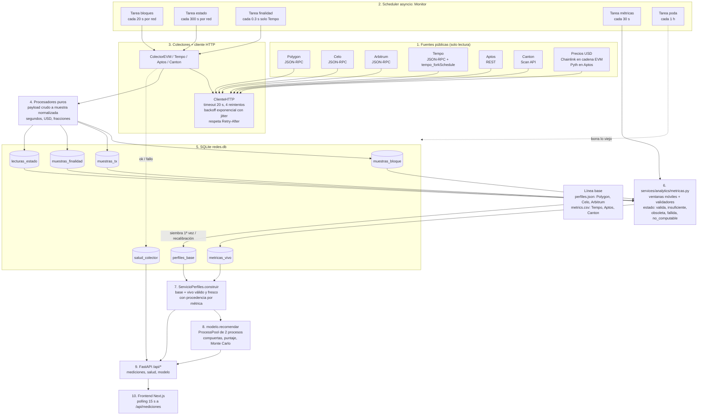
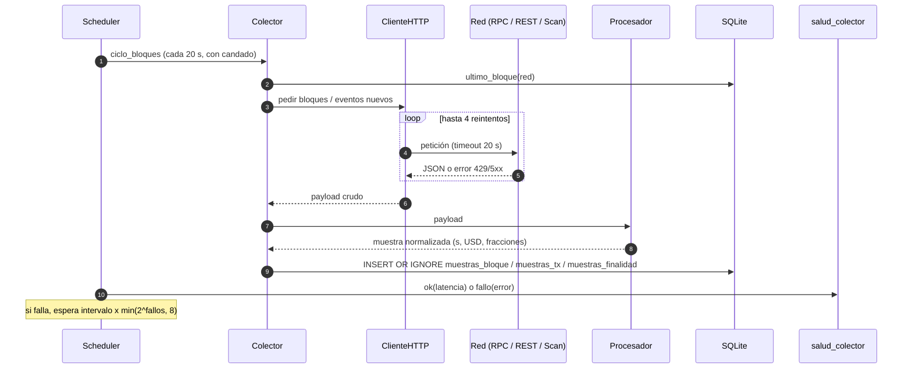
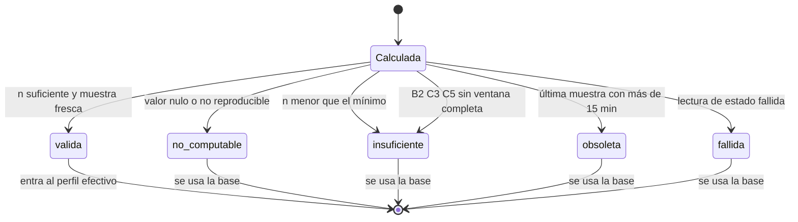
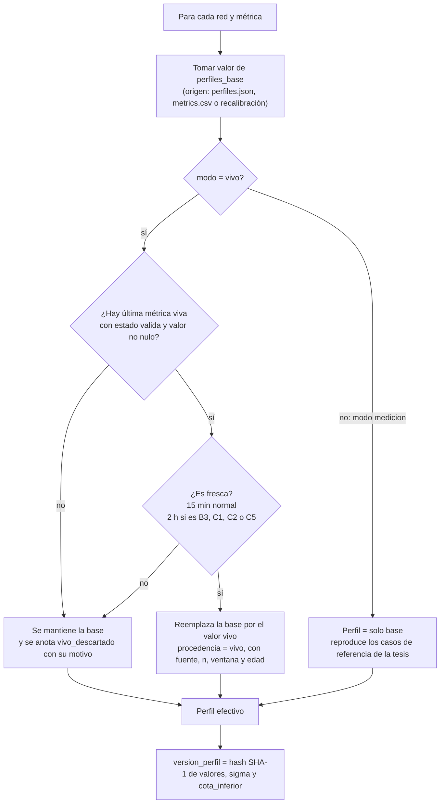
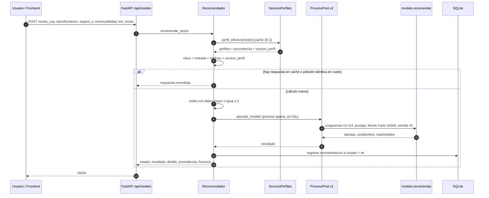

# Guion: cómo el modelo obtiene los datos y qué pasa después

Guion para explicar el pipeline de datos de punta a punta: de dónde sale cada dato, cada cuánto se toma, qué es "tiempo real" y qué no, cómo se valida, cómo se mezcla con la línea base y cómo llega al modelo de la tesis. Todo lo de aquí sale del código (`backend/app/`), no de memoria; las rutas están citadas para poder verificarlas.

---

## 0. Apertura (30 segundos)

> "La aplicación no ejecuta pagos: **recomienda en qué red liquidar** un pago en COP. Para recomendar, el modelo de la tesis necesita un **perfil de 14 métricas por red**. Ese perfil sale de dos fuentes: una **línea base** medida en periodos largos y un **monitoreo casi en tiempo real** que consulta los registros públicos de las seis redes. Si el dato en vivo es válido y fresco, reemplaza a la base; si no, se usa la base y la respuesta dice de dónde vino cada número. Nada se simula: lo que falta se muestra como falta."

Una precisión que conviene decir desde el inicio:

> "**Casi tiempo real** significa *sondeo periódico* (polling), no streaming. Ninguna red nos empuja eventos: nosotros preguntamos cada cierto tiempo."

---

## 1. Diagrama general (el mapa completo)

**Cómo narrarlo:** "De izquierda a derecha y de arriba abajo hay diez pasos. Los pasos 2 a 6 corren solos en segundo plano desde que arranca el servidor; los pasos 7 a 10 solo se activan cuando alguien abre la interfaz o pide una recomendación."

---

## 2. Qué se sondea y cada cuánto (la tabla que más se pregunta)

Todo es configurable por variables de entorno (`backend/app/config.py`). Estos son los valores por defecto:

| Tarea | Frecuencia | Qué trae | Variable |
|---|---|---|---|
| **Bloques / eventos** | cada **20 s** por red | bloques nuevos, sus transacciones y recibos | `INTERVALO_BLOQUES_S` |
| **Estado** | cada **300 s** (5 min) por red | validadores, configuración, calendario de forks, precio de APT | `INTERVALO_ESTADO_S` |
| **Finalidad (solo Tempo)** | cada **0,3 s** | último bloque `finalized` | `INTERVALO_FINALIDAD_S` |
| **Cálculo de métricas** | cada **30 s** | lee SQLite y calcula las métricas de las 6 redes | `INTERVALO_METRICAS_S` |
| **Poda** | cada **1 h** | borra muestras fuera de ventana | (fijo) |
| **Precios USD** | caché de **60 s** | Chainlink (EVM) / Pyth (Aptos) | (fijo) |
| **Frontend** | **15 s** a `/api/mediciones`; 60 s a `/api/modelo` (info) | lo que ya está calculado | `REFRESCO_MEDICIONES_MS` |
| **Recalibración** | **bajo demanda** (botón) | corrida por lotes de T/A/C | `POST /api/recalibracion` |

Detalles que evitan malentendidos:

- **Escalonado:** las redes arrancan desfasadas `i × 1,5 s` para no golpear a todos los RPC a la vez (`scheduler.py`).
- **Sin solapamiento:** cada par `(red, componente)` tiene un candado; si el ciclo anterior sigue en curso, el nuevo se salta.
- **Tope por ciclo** (para no ahogarse en redes rápidas):
  - EVM y Tempo: máx. **40 bloques** por ciclo (10 en el primer arranque). Si el sondeo se atrasa más que eso, se toman los **más recientes** y los saltados se registran.
  - Aptos: **6 bloques** por ciclo (bloques de ~20 ms: es una muestra, no un censo).
  - Canton: hasta **10 páginas de 200 eventos** por ciclo, con pausa de 0,2 s entre páginas.
- **Canton submuestrea** 1 de cada 4 veredictos (`CANTON_SUBMUESTREO`); el tráfico de A3 se reescala por ese factor.
- **Latencia de punta a punta (peor caso):** un evento nuevo en la red tarda hasta ≈ 20 s (colector) + 30 s (cálculo) + 15 s (frontend) ≈ **65 s** en verse en pantalla. Cada vez que se recalculan las métricas se invalidan las cachés, así que la caché de 30 s no suma.

---

## 3. ¿Qué es tiempo real y qué no? (el inciso central)

Hay **cuatro niveles**, de más a menos "vivo":

### Nivel A: Sondeo continuo (el único realmente "tiempo real", W_L)

| Métrica | Red | Cómo |
|---|---|---|
| **B2 finalidad** (τF − τ1) | **Tempo** | cada 0,3 s pide `eth_getBlockByNumber("finalized")`. Cuando el número cambia, guarda `tau_f` = hora en que lo vimos y `tau_1` = timestamp del bloque. |

Por qué solo Tempo: la finalidad no deja un evento posterior que la registre; hay que *estar mirando* cuando ocurre. Su resolución es ≈ 0,3 s + latencia de red.
**Aptos B2 no se puede**: los bloques (~20 ms) son más rápidos que un round-trip HTTP. Se queda en la línea base con esa razón escrita.

### Nivel B: Casi tiempo real, sondeo de 20 s, ventanas móviles

Se leen bloques/eventos nuevos cada 20 s, se guardan en SQLite y cada 30 s se recalculan las métricas sobre una ventana móvil:

| Ventana | Métricas | Qué significa |
|---|---|---|
| **Flujo, 15 min** | B1 (p95 de la diferencia entre bloques consecutivos) en EVM, Tempo, Aptos | refleja el último cuarto de hora |
| **Distribución, 24 h** | A1, A2, A3, C4, D1, D2, D3, B3; C1/C2 de EVM; B1/B2 de Canton | refleja el último día |
| **Finalidad, 72 h** | B2 de Tempo | mediana de τF − τ1 |
| **Continuidad, 14 días** | C3 (huecos) y C5 (cambios) | ventana larga |

### Nivel C: Lecturas de estado cada 5 min

Datos que cambian lento: se leen una vez cada 300 s y se guardan con su hora en `lecturas_estado`.

| Dato | Red | Alimenta |
|---|---|---|
| `ValidatorConfigV2.getActiveValidators()` | Tempo | C1, C2 (voto igualitario: C1 = 1/N) |
| `tempo_forkSchedule` | Tempo | C5 (activaciones de fork en 14 d) |
| `ValidatorSet` (pesos de voto) | Aptos | C1, C2 |
| `ExecutionConfig` (BCS decodificado, límite de gas del bloque) | Aptos | B3 |
| Precio APT/USD (Pyth on-chain) | Aptos | A1, A2 (marca si está congelado) |
| `/v0/dso` (pesos de Super Validators, tráfico base) | Canton | C1, C2, B3 |
| Ranura de implementación del proxy de USDC | Polygon, Celo, Arbitrum | C5 |
| Verificación del contrato USDC | Polygon, Celo, Arbitrum | validez del token de pago |

Estas lecturas valen hasta **2 h** (`OBSOLESCENCIA_ESTADO_S`), no 15 min.

### Nivel D: Solo línea base (no se mide en vivo)

La razón exacta de cada una está en `services/network/registry.py` y se muestra en la UI (`razon_solo_base`):

| Red | Métricas solo base | Razón |
|---|---|---|
| **Polygon, Celo, Arbitrum** | A3, A4, B2, B2b, B3, D2, D3 | la regresión de A3 no es concluyente; B2/A4 necesitan el rastreador de anclaje en Ethereum (no existe aún); B3 es caudal sostenido de 1 h sobre 90 días; D2/D3 no son reproducibles desde recibos |
| **Aptos** | B2, C3, D2, C5 | B2: bloques más rápidos que HTTP; C3: cobertura de pares < 0,9; D2: definición A-5 sin fijar; C5: la definición del benchmark no mide mutabilidad de la ruta de pago |
| **Canton** | D1 | sujeto declarado: no aplica por arquitectura |
| **Tempo** | ninguna | las 14 métricas del catálogo se miden en vivo |

> **Frase para el jurado:** "Un `no_computable` con su razón exacta es un resultado válido. Un número adivinado es peor que no tener número." (regla de oro del repositorio).

### Métricas en vivo por red

| Red | Responsable | Métricas en vivo |
|---|---|---|
| Polygon / Celo / Arbitrum | Dilan | A1 A2 B1 C1 C2 C3 C4 C5 D1 (9) |
| Tempo | Jerónimo | A1 A2 A3 B1 B2 B3 C1 C2 C3 C4 C5 D1 D2 D3 (14) |
| Aptos | Jerónimo | A1 A2 A3 B1 B3 C1 C2 C4 D1 D3 (10) |
| Canton | Jerónimo | A1 A2 A3 B1 B2 B3 C1 C2 C3 C4 C5 D2 D3 (13) |

---

## 4. Qué hace cada colector (paso a paso)

### 4.1 EVM: Polygon, Celo, Arbitrum (`collectors/evm.py`)

1. **Verifica el USDC** una vez: `symbol() == "USDC"`, `decimals() == 6`, `eth_getCode` no vacío. Si no cuadra, el colector falla (no se usa un token sin verificar).
2. `eth_blockNumber` → decide el rango (continúa desde el último guardado, máx. 40).
3. `eth_getBlockByNumber(n, true)` en **lote de 10** → muestras de bloque (timestamp, productor = `miner`, gas, ocupación).
4. `eth_getLogs` del evento `Transfer` del contrato USDC en ese rango (el topic se calcula con keccak, no se copia).
5. **Candidatas a pago:** transacciones dirigidas al USDC *o* cuyo hash aparece en un log `Transfer`.
6. `eth_getTransactionReceipt` en **lote de 25** → `tx_de_pago_evm`: costo = `(gasUsed × effectiveGasPrice + l1Fee) / 1e18 × precio_nativo`; `tiene_transfer`, `estado_ok`, `patrocinada` (EIP-3009, EIP-7702, ERC-4337, `feeCurrency`).
7. Precio nativo desde **Chainlink** (ETH en Arbitrum, MATIC/POL en Polygon, CELO en Celo). Cada feed se verifica con `description()` y `decimals()`, y se rechaza si tiene más de 1 h. Si falla, `fee_usd` queda **nulo**, nunca inventado.

### 4.2 Tempo (`collectors/tempo.py`)

- **Bloques:** igual que EVM, pero trae **todas** las transacciones y recibos (en Tempo todo es pago TIP-20). El productor viene de `consensusContext.proposer`. Costo en USD = `gasUsed × effectiveGasPrice / 1e18`, solo si el `feeToken` se verificó (`decimals()` entre 1 y 18); precio fijado en 1,0 por ser stablecoin. Detecta `feePayer` (D1), evento `TransferWithMemo` (D2) y varias transferencias/activos (D3).
- **Estado (300 s):** validadores activos del precompilado `0xCCCCCCCC…01` y `tempo_forkSchedule`.
- **Finalidad (0,3 s):** descrito en el nivel A.

### 4.3 Aptos (`collectors/aptos.py`)

- **Bloques:** `GET /` para la altura, luego `blocks/by_height/{h}?with_transactions=true` **en paralelo** para 6 alturas. Resuelve a qué activo pertenece cada `FungibleStore` (para D3). Costo = `gas_used × gas_unit_price / 1e8 × precio_APT`.
- **Estado:** decodifica el blob BCS de `ExecutionConfig` (se exige consumir **todos** los bytes: esa exactitud prueba el layout), lee `ValidatorSet` y el precio de Pyth.
- **Pyth:** el feed ID se obtiene de la API de Hermes y se **verifica contra la tabla on-chain** (el `price_identifier` devuelto debe coincidir). Si el precio lleva más de 24 h sin actualizarse, se marca **congelado** y la nota de A1/A2 lo dice.

### 4.4 Canton (`collectors/canton.py`)

- No hay bloques: hay un **flujo de eventos** (`POST /v0/events`) con un **cursor persistido** en SQLite (`cursor_eventos`), así un reinicio retoma donde quedó. Si no hay eventos y el cursor tiene más de 10 min, prueba con `migration_id + 1`.
- De cada evento extrae: veredicto (latencia `finalization_time − record_time`, costo de tráfico, rechazado o no), transferencias (meta/memo, salidas múltiples), latidos `ValidatorLicense_ReportActive` (para C3) y cambios estructurales del DSO (para C5).
- **Estado (300 s):** `/v0/dso` → pesos de Super Validators, precio del tráfico y límites base.

---

## 5. Qué pasa con el dato una vez recolectado

### 5.1 Procesar → normalizar → guardar

Puntos clave a decir:

- **Procesadores = funciones puras** (`processors/*.py`): no tocan red ni base de datos, así se prueban fácil.
- **Idempotencia:** las inserciones usan `INSERT OR IGNORE` con llave `(red, numero)` o `(red, hash)`; repetir una lectura nunca duplica.
- **Tres tablas de muestras** más `lecturas_estado` (lecturas puntuales con hora, consultables como historial).
- **Continuidad incremental (C3):** en cada ciclo de bloques se resume el ciclo (pares consecutivos, suma, mediana, huecos grandes, bloques saltados) y se guarda como `c3_ciclo`. Así la ventana de 14 días **no exige conservar cada bloque**.

### 5.2 Fallos y recuperación

| Capa | Mecanismo |
|---|---|
| HTTP | 4 reintentos (5 intentos), backoff `1 s × 2^i` con jitter (tope 60 s); respeta `Retry-After`; **no** reintenta 4xx |
| Componente | tras un fallo espera `intervalo × min(2^fallos, 8)`; un éxito reinicia el contador |
| Registro | `salud_colector` guarda `ultimo_ok`, `ultimo_error`, `fallos_consecutivos`, latencia |
| Estado de red | `ok` · `degradada` (falla algún componente) · `caida` (falla `bloques`) → visible en `/api/salud` y en Monitoreo |
| Precio | si no hay precio, `fee_usd = NULL`; la muestra se guarda, el costo no |

### 5.3 Poda (cada hora)

Se borra lo que queda fuera de `ventana × 1,1`: muestras de bloque y tx > 26,4 h, finalidad > 79,2 h, lecturas de estado y métricas > 15,4 días. SQLite no crece sin límite.

---

## 6. De muestras a métricas (cada 30 s)

`Monitor.calcular_todas()` corre en un hilo (`asyncio.to_thread`) y, para cada red:

1. `calcular_metricas(red, ctx)` consulta SQLite con la ventana de cada métrica.
2. Cada resultado es un `MetricaValor` con `valor`, `sigma` (error estándar por *bootstrap* de 200 remuestreos con semilla fija, cuando hay ≥ 10 datos), `n`, `ventana_s`, `fuente`, `nota` y `estado`.
3. Se insertan en `metricas_vivo` (historial; se lee la última por red y métrica).
4. Se invalidan las cachés de perfil e instantánea.

**Qué calcula cada una (resumen):**

| Métrica | Cálculo |
|---|---|
| A1 | mediana del costo en USD por transferencia |
| A2 | p95 / mediana del costo |
| A3 | pendiente de ln(costo) frente a la ocupación del bloque (Canton: frente al tráfico por cubetas de 10 s) |
| B1 | p95 de la diferencia de timestamps entre bloques **consecutivos** (Canton: p95 de `finalization − record`) |
| B2 | mediana de τF − τ1 |
| B3 | (gas del bloque / gas mediano por tx) / cadencia mediana, dividido entre 18 TPS requeridos |
| C1 | HHI (Herfindahl) de productores (EVM) o de pesos de consenso (T/A/C) |
| C2 | mínimo de operadores que suman más del 50 % |
| C3 | 1 − fracción de tiempo en huecos > 10× la cadencia mediana |
| C4 | fracción de transacciones fallidas |
| C5 | cambios de implementación/fork/gobernanza en 14 d |
| D1 / D2 / D3 | fracción de patrocinadas / con memo / con varias transferencias |

### 6.1 Estados de una métrica (los valida `validadores.py` y `metricas.py`)

**Mínimos de muestras** (`N_MIN`): B1 30 · B2 100 · B3 30 · C1 100 · C3 100 · C4 50 · A1 30 · A2 30 · A3 50 · D1 30 · D2 30 · D3 30. Las lecturas de estado (C1/C2 de consenso, C5 de Tempo) usan mínimo 1.

**Ventana completa obligatoria (solo estas tres):**

- **B2 de Tempo:** hay que haber observado ≥ 99 % de las 72 h.
- **C3 y C5:** ≥ 99 % de los 14 días.

> "Una cota parcial de C5 subestimaría los cambios; por eso hasta que no se cubra la ventana, sigue vigente la base."

**Consecuencia práctica de arranque (aplicable al servidor recién encendido):**

| Tiempo encendido | Qué ya es "vivo" |
|---|---|
| Minutos | B1 y las lecturas de estado (C1/C2, B3 de Aptos/Canton) |
| Horas | A1, A2, A3, C4, D1–D3, B3 de Tempo, en cuanto se junte el `n` mínimo |
| 72 h | B2 de Tempo |
| 14 días | C3 y C5 |

**Dos salvedades de muestreo:** C3 exige cobertura ≥ 0,9 de pares consecutivos; si no (Aptos, y posiblemente Arbitrum), queda `no_computable` y se usa la base. C1/C2 de EVM son sobre la **muestra** de bloques, no un censo.

---

## 7. Línea base + vivo = perfil efectivo

`ServicioPerfiles.construir(modo)`:

- **De dónde sale la base** (`container.sembrar()` + `baseline.py`): la primera vez que arranca, siembra `perfiles_base` con `perfiles.json` (Polygon/Celo/Arbitrum, medidos 90 días) y `resultados/metrics.csv` (Tempo/Aptos/Canton). El botón **Recalibrar** puede reemplazar la base de T/A/C.
- **Conversiones de la base de T/A/C** (para que el CSV hable el idioma del modelo): A2 = p95/mediana · B3 × 48/18 · C3 × 100 (porcentaje) · **C1 del modelo = C1b** (HHI de consenso) · `sigma = 0` · no computable → `null` · B3 de Canton se marca `cota_inferior`.
- **Procedencia:** cada métrica del perfil dice si es `base` o `vivo`, su fuente, edad, `n` y ventana. La interfaz lo muestra.
- **`version_perfil`:** hash del contenido. Si ningún valor cambió, la versión es la misma y la recomendación sale de caché.

---

## 8. Del perfil al modelo y a la pantalla

**Qué hace el modelo con el perfil** (`modelo.py`, sin editar):

1. **Vector del caso** (monto, espera, transfronterizo, irrevocabilidad) → pesos interpolados entre tres escenarios: remesas, comercio, alto valor. Da la **certidumbre κ**.
2. **Compuertas** (una red que falla queda inadmisible con su motivo):
   - **G1** latencia B1 > 20 s en comercio
   - **G2** B2 nulo (sin finalidad anclada)
   - **G3** D2 ≤ 0
   - **G4** capacidad B3 < 1 (salvo `cota_inferior`)
3. **Puntaje:** cada métrica a [0, 1] por umbrales objetivo/inaceptable → media por bloque → media geométrica ponderada. Las métricas nulas se **excluyen**.
4. **Monte Carlo:** 10 000 réplicas con ruido gaussiano según `sigma` y pesos Dirichlet. Una red entra a una banda inferior solo si supera a todas las de la banda actual en ≥ 85 % de las réplicas.
5. **Resultado:** la recomendación es la **banda 1** (si tiene varias redes, están empatadas).

**Estados de la respuesta:** `ok` · `datos_insuficientes` (< 2 redes con datos) · `sin_redes_admisibles`.

**Rendimiento:** ≈ 4 s la primera vez con 6 redes y 10 000 réplicas; < 0,3 s desde caché. El pool de procesos se precalienta al arrancar.

**Lo que consume la vista de Monitoreo** (`/api/mediciones` → `ServicioInstantanea`): para cada red y métrica, el valor efectivo, su origen (vivo/base), edad, `n`, ventana, la última lectura viva con su estado, la razón por la que es solo base, y la salud de cada componente del colector.

---

## 9. Los dos modos y la recalibración

| | Modo `vivo` (por defecto) | Modo `medicion` |
|---|---|---|
| Datos | base + vivo válido y fresco | solo base |
| Uso | decisión con las condiciones actuales | reproducir los casos de referencia de la tesis |

**Recalibración (botón, `POST /api/recalibracion`)** no es tiempo real; es por lotes:

1. Lanza `backend/benchmark/main.py --collect` en un **subproceso aislado** (`backend/data/recalibracion/<id>/`); no toca `resultados/` del repositorio.
2. Sigue el avance por las marcas `>>>` del log (8 pasos esperados) y permite cancelar.
3. Al terminar, reconstruye los perfiles base de **Tempo, Aptos y Canton** desde su `metrics.csv` y sube la versión de la base.
4. Invalida cachés para que la siguiente recomendación use la base nueva.
5. Un solo trabajo a la vez. **Polygon, Celo y Arbitrum no tienen colector por lotes** en el repositorio: se reportan `no_disponible` (sus métricas en vivo se acumulan igual).
6. No resuelve `aptos.B2` ni `aptos.D2`.

---

## 10. Reglas de honestidad que sostienen todo el pipeline

1. **Regla de oro:** ninguna métrica se puntúa si no se deriva de una consulta reproducible al registro público de la red.
2. **Cada identificador se verifica en vivo o se calcula** (USDC con `symbol`/`decimals`/`getCode`, feeds de Chainlink con `description()`, topics con keccak, feed de Pyth contra la tabla on-chain, layout BCS con consumo exacto de bytes).
3. **Sin datos simulados:** lo que falta se muestra como `null`, `insuficiente` o `no_computable`.
4. **Procedencia siempre visible:** vivo o base, de qué fuente, con qué `n` y qué edad.
5. **Caídas visibles:** una red `degradada` o `caida` se ve en la interfaz; no se esconde.

### Limitaciones que hay que decir en voz alta

- Es **polling**, no streaming; el retardo máximo a pantalla es ≈ 65 s.
- En redes rápidas (Aptos, Arbitrum) lo recolectado es una **muestra** de bloques.
- **Aptos B2** no es medible por HTTP; **Aptos D2** no tiene definición A-5 fijada.
- **Precio de APT puede estar congelado** (Pyth on-chain); se marca en la nota.
- **Canton B3** es una cota inferior (asignación gratuita por miembro, no techo agregado). No decir "Canton no sostiene 48 TPS" sin esa advertencia.
- **Canton B2 en vivo es la mediana**; la base de `metrics.csv` usa el p95 (discrepancia heredada).
- **C3 y C5 tardan 14 días** de operación continua en volverse "vivos"; B2 de Tempo tarda 72 h.
- Los **RPC públicos son inestables**; se cambian con las variables `RPC_*`.
- Las ventanas de la línea base de T/A/C son de la muestra reducida del benchmark, no la ventana completa de 14 días del plan.

---

## 11. Cierre (20 segundos)

> "En resumen: seis redes, consultadas por sondeo cada 20 segundos; las lecturas lentas cada 5 minutos; la finalidad de Tempo cada 0,3 segundos. Cada 30 segundos se convierten en métricas sobre ventanas móviles y se validan. Solo lo válido y fresco reemplaza a la línea base, y cada número conserva su procedencia. Con ese perfil, el modelo de la tesis decide en qué red conviene liquidar, y si no hay datos suficientes, lo dice en vez de inventar."

---

## Anexo: mapa de archivos para verificar cada afirmación

| Tema | Archivo |
|---|---|
| Frecuencias, ventanas, umbrales | `backend/app/config.py` |
| Orquestación, candados, backoff, poda | `backend/app/pipelines/scheduler.py` |
| Reintentos HTTP, lotes JSON-RPC | `backend/app/pipelines/collectors/base.py` |
| Colectores | `backend/app/pipelines/collectors/{evm,tempo,aptos,canton,precios}.py` |
| Normalización | `backend/app/pipelines/processors/{evm,tempo,aptos,canton}.py` |
| Estados y rangos | `backend/app/pipelines/validators/validadores.py` |
| Cálculo de métricas, `N_MIN` | `backend/app/services/analytics/metricas.py` |
| C3 incremental | `backend/app/services/analytics/continuidad.py` |
| Línea base | `backend/app/services/analytics/baseline.py` |
| Qué es vivo y qué es solo base | `backend/app/services/network/registry.py` |
| Perfil efectivo (base + vivo) | `backend/app/services/decision/perfiles.py` |
| Recomendador, caché, pool | `backend/app/services/decision/recomendador.py` |
| Modelo de la tesis (no se edita) | `backend/modelo/modelo.py` |
| Esquema SQLite | `backend/app/db/migrations.py` |
| Recalibración | `backend/app/services/recalibracion/trabajos.py` |
| Polling del frontend | `frontend/src/modelo/cliente.ts` |
